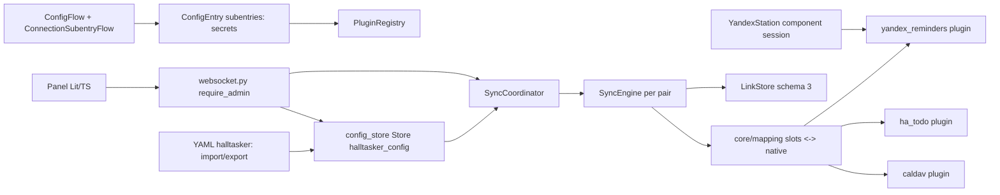

# Requirements

### Overview & Goals

Написать архитектуру HAlltasker v2 как **два документа** — `docs/v2/SPEC.md` и `docs/v2/ARCHITECTURE.md` (английский, agent-facing, binding) — до того, как в проекте разведётся несколько несовместимых подсистем. Код в этом плане не меняется; implementation-issues создаются отдельным шагом после утверждения текста (решение владельца).

v2 объединяет три линии:

1. **Core с плагинами** по решениям IT-41/IT-46: `CanonicalItem(kind, fields)`, схема полей вместо константы `FIELDS`, per-field capabilities `none/partial/full`, движок `SyncEngine` без переписывания алгоритма.
2. **Прямые плагины** вместо собственных `todo.*`-платформ: `caldav`, `yandex_reminders` (позже `jira`, `yandex_tracker`) читают и пишут напрямую и объявляют полный набор native-полей; `ha_todo` остаётся для stock-интеграций. Платформы §4a/§4b v1.3 из v2 **убираются совсем**.
3. **GUI** — custom panel HA (Lit + TypeScript) для настройки подключений (`Connection`), узлов и пар с наглядным матчингом атрибут-в-атрибут, выбором направления и выбором списка из discovery.

### Решения владельца, зафиксированные в этом плане

| Вопрос | Решение |
|---|---|
| Источники | Прямые плагины; `todo.*`-платформы HAlltasker убрать |
| Топология | **Только пары**; несколько независимых синхронизаторов (yandex↔apple, jira↔tracker, yandex→tracker односторонняя); N-node и Group-хаб не вводятся |
| Переиспользование credentials | **Подключения** (`Connection`): плагин + credentials + не-секретные настройки; `yandex1`, `yandex2` — разные аккаунты, участвуют в разных парах. Плагины без собственных credentials (`ha_todo`; `yandex_reminders`, который целиком работает через компонент YandexStation) — встроенные подключения без формы credentials |
| Политика конфликтов | На пару (`prefer_a`/`prefer_b`) **плюс переопределение по полю** в строке маппинга |
| Хранение | ConfigEntry (credentials подключений) + собственный `Store` (узлы, пары, маппинги); GUI пишет через websocket API |
| YAML | Рендер **сохраняется**: export/import в панели и одноразовый импорт `halltasker:` при старте — для восстановления |
| Списки | Только выбор существующих контейнеров через discovery плагина; `create_container` зарезервирован в контракте, не реализуется |
| Фронтенд | Lit + TypeScript, собранный бандл коммитится в `custom_components/halltasker/frontend/` |
| Результат плана | Только документы; без issues и без кода |

### Scope

**In scope**

- `docs/v2/SPEC.md`: цели, ключевые решения, термины, FR (functional requirements — нумерованные функциональные требования, как FR-1…FR-14 в v1.4) для подключений/узлов/пар/маппинга/конфликтов/хранения/YAML/GUI/websocket/безопасности, нефункциональные требования (NFR), acceptance-сценарии, миграция с v1.
- `docs/v2/ARCHITECTURE.md`: модель и обобщённое ядро, контракт плагина v2 и три плагина с матрицами полей, слой конфигурации (ConfigEntry + subentries, Store, YAML import/export, websocket API, координатор, сенсоры, диагностика), панель (структура, сборка, экраны), тестирование, раздел «Changes against v1.3».
- Короткие указатели на v2 в `docs/SPEC.md` §3 и `docs/ARCHITECTURE.md` §13 (одна строка каждый; v1 остаётся binding для открытых v1-issues).

**Out of scope**

- Любой код Python/TypeScript, изменения тестов, `manifest.json`, `requirements_dev.txt`.
- Создание Tracker-issues (следующий шаг после утверждения документов).
- `docs/ru/*` (поддерживает владелец), `README.md`.
- Плагины `jira`/`yandex_tracker`/BuyMeAPie: в документе только требования к контракту, которые они должны удовлетворять, без их спецификации.
- Calendar events (решение 2026-10-28), N-node группы, create_container, RRULE.

### User Stories

- Как владелец, я хочу в панели HA создать подключение `yandex1` (CalDAV, логин/пароль один раз) и использовать его в парах yandex↔apple и yandex→tracker, чтобы менять пароль в одном месте.
- Как владелец, я хочу выбрать список назначения из реального перечня коллекций/проектов, потому что имена списков могут быть жёстко заданы в разных системах.
- Как владелец, я хочу видеть два столбца полей (что даёт плагин A и плагин B), предзаполненное соответствие по ролям, и отрезать лишнее или перепривязать, чтобы синхронизировать ровно нужные атрибуты.
- Как владелец, я хочу задать направление пары (двустороннее / только A→B / только B→A) и для отдельного поля указать авторитетную сторону.
- Как владелец, я хочу прогнать dry-run новой пары из панели до включения и видеть статус/ошибки пар там же.
- Как владелец, я хочу экспортировать всю конфигурацию в YAML и импортировать её при восстановлении HA.

### Functional Requirements (что должны содержать документы)

1. SPEC v2 задаёт сущности `Connection`, `Node`, `Container`, `Pair`, `FieldMap`/`Slot`, `ValueMap`, `ItemSchema`, `CanonicalItem`; каждая с инвариантами и примером YAML-экспорта.
2. SPEC v2 переписывает §2 «Key decisions»: конфигурация через UI + Store, YAML = import/export; прямые плагины; credentials в ConfigEntry; «только пары» с явным обоснованием.
3. FR для discovery контейнеров, матчинга полей (роль → предзаполнение, drop, value map для enum), direction presets, conflict per field, стабильных uuid (переименование не сбрасывает ссылки; смена контейнера — сброс с подтверждением).
4. FR для панели: экраны Connections / Nodes / Pairs / Pair editor / Status / Export-Import; admin-only; credentials write-only.
5. FR для websocket API и сервисов (`sync_now`, `dry_run`, `reload` → re-read store/import).
6. Acceptance-сценарии v2 (группа A v1 сохраняется неизменной как регрессия, плюс сценарии на расширенные поля, value map, per-field conflict, два подключения одного плагина, import/export round-trip).
7. ARCHITECTURE v2 содержит binding-сигнатуры (dataclasses, контракт `Plugin`, websocket-команды, схемы Store), как в v1.3 §2–§9.
8. Все факты о HA API проверены по установленному пакету HA 2026.9.4 (`.venv`), не по интернету; в документе указано, что именно проверено.

### Non-Functional Requirements

- Английский язык, без русских фрагментов (кроме примеров имён списков в YAML).
- Стиль и структура как у v1.3: нумерованные разделы, таблицы фактов, кодовые блоки с сигнатурами, раздел «Changes against v1.3».
- Core по-прежнему не импортирует `homeassistant`; секреты никогда не попадают в core, Store конфигурации, логи и диагностику.
- Совместимость с правилами репозитория: `requirements` manifest — только CalDAV-библиотеки (как v1.2); Node.js нужен только разработчику панели, бандл коммитится.

# Technical Design

### Current Implementation

- [ARCHITECTURE.md](air-file://4tnl0853sb4p2u8bgfbb/Users/s.parfyenov/Documents/git/HAlltasker/docs/ARCHITECTURE.md?type=file&root=%252F) v1.3: пары `SyncPair(a, b)` над строками `todo.*`; один плагин `ha_todo`; `CanonicalTask` с четырьмя полями и `FIELDS`; `Capabilities` только `due`/`description`+операции; `PairLinks`/`LinkStore` schema 2; один глобальный lock, chained run; конфиг — YAML only, `config_flow.py` — import; §4a/§4b — собственные `todo.*`-платформы с credentials inline в `caldav[]`.
- В коде (`custom_components/halltasker/`, 2319 строк) реализованы core, `ha_todo`, coordinator, sensor, schema; `todo.py`/`caldav_client.py`/`reminders_todo.py` из §4a/§4b **ещё не написаны** — v2 их отменяет без выбрасывания кода.
- IT-41 (вердикт) и IT-46 (открыта): `CanonicalItem(kind, fields)`, схема полей, per-field caps, LinkStore schema 3, без N-node.
- Проверено в `.venv` (HA 2026.9.4): `config_entries.ConfigSubentryFlow`/`ConfigSubentry`/`ConfigFlow.async_get_supported_subentry_types` есть; `panel_custom.async_register_panel`; `http.HomeAssistantHTTP.async_register_static_paths`; `websocket_api.require_admin/websocket_command/async_register_command/async_response`; `issue_registry.async_create_issue`; `TodoItem` = summary/uid/status/due/description/completed — подтверждает, что через `todo.*` расширенные поля недостижимы.

### Key Decisions

1. **Отдельные файлы `docs/v2/SPEC.md` и `docs/v2/ARCHITECTURE.md`**, v1 не переписывается. Открытые v1-issues (IT-43, IT-45, IT-57) ссылаются на номера разделов v1.3; замена в месте сломала бы их. В v1 — по одной строке-указателю (§3 SPEC, §13 ARCHITECTURE). При старте реализации v2 владелец решает, когда v2 становится `docs/SPEC.md`.
2. **Термин — `Connection`** (плагин + credentials + не-секретные настройки). Слово «профиль» в документах v2 не используется; схема полей из IT-41 называется `ItemSchema`.
3. **Одна ConfigEntry HAlltasker + subentry на Connection** (тип `connection`, `ConfigSubentryFlow` с формой по `credentials_schema` плагина). Credentials — в `subentry.data`, не-секретные настройки и ссылки — в Store. Альтернатива «ConfigEntry на подключение» отклонена: runtime (store, координатор, панель) должен быть один. Плагины с `credential_kind: none` (`ha_todo`, `yandex_reminders`) — встроенные подключения без subentry: собственных credentials у них нет; `yandex_reminders` целиком использует уже настроенный компонент YandexStation, его подключение несёт только не-секретную настройку «какой config entry YandexStation использовать», если их несколько.
4. **Маппинг хранится в паре, плагины о парах не знают.** Плагин отдаёт `CanonicalItem` с native-именами полей; `core/mapping.py` переименовывает в слоты и применяет `ValueMap`; обратно — на записи. Звезда §1 v1.3 сохраняется.
5. **Узлы и пары идентифицируются uuid**, namespace ссылок — по `pair.id` uuid и `node.id` uuid; имена — отдельное поле. Сброс ссылок только при смене контейнера узла или узлов пары (как FR-12.5).
6. **Конфликт: `pair.conflict` по умолчанию, `FieldMap.prefer` переопределяет.** `conflict.merge` получает `prefer_for(slot)`; остальная таблица решений §6.1 не меняется.
7. **LinkStore schema 3 без миграции данных v1** (pre-release, как v1.1 поступил со schema 1): `WARNING` + пустой store; первый цикл — `merge`.
8. **YAML**: формат экспорта = формат импорта = секция `halltasker:` v2. Импорт при старте только в пустой Store; при непустом Store — repairs issue. Экспорт редактирует секреты как `!secret halltasker_<connection>_<key>` и выводит рядом шаблон `secrets.yaml`; опция «включить секреты» — только по явному подтверждению в панели.

### Proposed Changes (содержание документов)

**`docs/v2/SPEC.md`** — разделы: 1 Goal; 2 Key decisions (таблица выше, переписанная); 3 Scope v2 (in/out); 4 Terms; 5 FR: FR-1 Connections, FR-2 Nodes & discovery, FR-3 Pairs & directions, FR-4 Field mapping & value maps, FR-5 Item schema & capabilities (бывшие FR-2), FR-6 Change detection/conflicts с per-field prefer (бывшие FR-4/FR-5), FR-7 Deletion (без изменений, ссылка), FR-8 Storage (config store + link store + ConfigEntry), FR-9 YAML import/export, FR-10 Panel, FR-11 Websocket API & services, FR-12 Security & diagnostics, FR-13 Plugins `ha_todo`/`caldav`/`yandex_reminders` (требования, заменяющие FR-13/FR-14 v1.4), FR-14 Migration from v1; 6 NFR; 7 Acceptance; 8 Risks; 9 Changes against v1.4.

**`docs/v2/ARCHITECTURE.md`** — разделы: 1 Overview + дерево модулей; 2 Config model (Connection/Node/Container/Pair/FieldMap/ValueMap/DirectionRule); 3 Item model & schema (CanonicalItem, ItemSchema, FieldSpec, Capabilities per-field); 4 Plugin contract v2; 4a `ha_todo`; 4b `caldav`; 4c `yandex_reminders`; 5 Mapping & downgrade; 6 Engine deltas (что меняется в §6.1 v1.3 и что нет); 7 Config store & ConfigEntry/subentries; 8 YAML import/export; 9 Websocket API; 10 Coordinator (пары из Store, перезапуск при `config/save`); 11 Link store schema 3; 12 Sensors/services/diagnostics; 13 Panel; 14 Logging; 15 Testing; 16 Future; 17 Changes against v1.3.

### Data Models / Contracts (binding для ARCHITECTURE v2)

```python

# core/model.py (no HA imports)

FieldType = Literal["str", "text", "enum", "due", "datetime", "int", "str_list"]
FieldCap = Literal["none", "partial", "full"]      # due: partial = date only

@dataclass(frozen=True)
class FieldSpec:
    name: str                 # native field name as the plugin names it
    type: FieldType
    role: str | None = None   # suggested slot: title, description, status, due, priority, tags
    read: bool = True
    write: bool = True
    values: tuple[str, ...] = ()   # enum only

@dataclass(frozen=True)
class ItemSchema:             # built per pair from the mapping, not global
    kind: str                 # "task"
    fields: tuple[FieldSpec, ...]      # one per mapped slot, named by slot
    match_key: tuple[str, ...] = ("title", "due")

@dataclass(frozen=True)
class CanonicalItem:
    kind: str
    fields: Mapping[str, Any]          # slot (core) or native name (plugin boundary)

@dataclass(frozen=True)
class Capabilities:
    create: bool; update: bool; delete: bool
    fields: Mapping[str, FieldCap]     # by native field name

@dataclass(frozen=True)
class Connection:
    id: str; name: str; plugin_id: str
    settings: Mapping[str, Any] = field(default_factory=dict)   # non-secret; e.g. yandex_station entry id for yandex_reminders
    interval: int = 300

@dataclass(frozen=True)
class Container:
    id: str; name: str; path: str | None = None; query: str | None = None

@dataclass(frozen=True)
class Node:
    id: str; name: str; connection_id: str; container: Container; kind: str = "task"

@dataclass(frozen=True)
class ValueMap:
    read: Mapping[str, str]            # native value -> canonical value
    write: Mapping[str, str]           # canonical value -> native value
    default: str | None = None

@dataclass(frozen=True)
class FieldMap:
    slot: str
    a: str | None                      # native field of node A; None = dropped
    b: str | None
    prefer: Literal["pair", "a", "b"] = "pair"
    value_map_a: ValueMap | None = None
    value_map_b: ValueMap | None = None

@dataclass(frozen=True)
class Pair:
    id: str; name: str; a: str; b: str                 # node ids
    direction: Literal["both", "a_to_b", "b_to_a"] = "both"   # preset; expands to DirectionRule pair
    mapping: tuple[FieldMap, ...]
    interval: int = 60; conflict: Literal["prefer_a", "prefer_b"] = "prefer_a"
    initial_sync: Literal["merge", "dry_run"] = "merge"; enabled: bool = True
    a_to_b: DirectionRule = DirectionRule(); b_to_a: DirectionRule = DirectionRule()
```

```python

# plugins/base.py

@dataclass(frozen=True)
class PluginDescriptor:
    plugin_id: str; name: str
    credentials_schema: Mapping[str, Any]   # JSON-schema-like dict rendered by the panel; {} when credential_kind == "none"
    settings_schema: Mapping[str, Any]
    fields: tuple[FieldSpec, ...]
    credential_kind: Literal["none", "basic", "token"]   # none = built-in connection, no own credentials (ha_todo, yandex_reminders)

class Plugin(ABC):
    descriptor: PluginDescriptor
    async def validate(self, connection: Connection, secrets: Mapping[str, str]) -> None      # AuthFailed | NodeUnavailable
    async def containers(self, connection: Connection, secrets) -> list[Container]            # discovery
    async def capabilities(self, node: Node, secrets) -> Capabilities
    async def list(self, node: Node, secrets) -> dict[str, CanonicalItem]              # native field names
    async def create(self, node, item: CanonicalItem, known_ids: frozenset[str], secrets) -> str
    async def update(self, node, external_id: str, item: CanonicalItem, changed: frozenset[str], secrets) -> None
    async def delete(self, node, external_id: str, secrets) -> None
    # reserved, not implemented in v2: async def create_container(...)

class AuthFailed(Exception): ...
class NodeUnavailable(Exception): ...
```

```python

# core/mapping.py (pure)

def schema_for(pair: Pair, fields_a: tuple[FieldSpec, ...], fields_b: tuple[FieldSpec, ...]) -> ItemSchema
def to_slots(item: CanonicalItem, side: Literal["a", "b"], pair: Pair) -> CanonicalItem       # rename + value_map.read
def to_native(item: CanonicalItem, side, pair, changed: frozenset[str]) -> tuple[CanonicalItem, frozenset[str]]
def caps_for_slots(caps: Capabilities, side, pair) -> Capabilities

# core/conflict.py

def merge(a, changed_a, b, changed_b, schema: ItemSchema, prefer_for: Callable[[str], Literal["a", "b"]]) -> CanonicalItem
```

Websocket-команды (`websocket.py`, все `@require_admin`): `halltasker/plugins`, `halltasker/config/get` (без секретов), `halltasker/config/save` (полный документ, voluptuous-валидация, применяется атомарно, координатор перезапускается), `halltasker/connections/containers`, `halltasker/nodes/fields` (FieldSpec + Capabilities узла), `halltasker/pairs/dry_run`, `halltasker/pairs/sync_now`, `halltasker/status/subscribe`, `halltasker/links/list`, `halltasker/links/reset`, `halltasker/config/export_yaml`, `halltasker/config/import_yaml`.

Store `halltasker_config` (schema 1): `{"schema": 1, "connections": [Connection], "nodes": [Node], "pairs": [Pair]}`; секреты — только `subentry.data`. Store `halltasker` schema 3: `pairs[<pair uuid>] = {nodes: [node uuid, node uuid], kind, initialized, links}`.

Плагины v2 и их поля (матрицы в §4a–4c): `ha_todo` — summary/description/status(enum needs_action|completed)/due по `supported_features`; контейнеры = все `todo.*`; credential_kind `none`; `caldav` — SUMMARY, DESCRIPTION, STATUS (enum NEEDS-ACTION|IN-PROCESS|COMPLETED|CANCELLED), DUE, PRIORITY (int 0–9), CATEGORIES (str_list), COMPLETED (datetime, read-only); завершение по RFC 5545 как в §4a v1.3; контейнеры = коллекции principal с VTODO; credential_kind `basic`; `yandex_reminders` — text, due (datetime, full), статус только на чтение/отмену; credential_kind `none` — собственных credentials нет, клиент и сессия берутся из компонента YandexStation (`hass.data["yandex_station"]`), в `Connection.settings` — только выбор config entry YandexStation, если их несколько; один контейнер `reminders`; retention отменённых напоминаний переезжает из платформы в плагин.

### File Structure

- Add `docs/v2/SPEC.md`, `docs/v2/ARCHITECTURE.md`.
- Modify `docs/SPEC.md` (одна строка в §3 «Not included» → ссылка на v2), `docs/ARCHITECTURE.md` (одна строка в §13 → ссылка на v2).
- Документируемое целевое дерево кода (описывается, не создаётся): `core/{model,mapping,schema_builder,diff,conflict,downgrade,matching,engine,actions,link_store,config_store}.py`, `plugins/{base,registry,ha_todo,caldav,yandex_reminders}.py`, `config_flow.py` (entry + `ConnectionSubentryFlow`), `websocket.py`, `panel.py`, `yaml_io.py`, `frontend/` (TS/Lit sources, `package.json`, rollup) → `custom_components/halltasker/frontend/halltasker-panel.js`.

### Architecture Diagram



### Risks

- **Открытые v1-issues (IT-43, IT-57) делают §4a/§4b**, которые v2 отменяет. В SPEC v2 §9 «Migration» явно сказать: до старта v2 работа по §4a/§4b допустима только как исследование клиентов (код CalDAV/Alice переиспользуется плагинами); владельцу предложить перенаправить IT-57.
- **Subentry reauth**: reauth-flow в HA — на уровне entry; для подключения документировать `reconfigure` subentry-flow + repairs issue при `AuthFailed`. Проверить сигнатуры в `.venv` при написании §7. Для `yandex_reminders` reauth не наш — протухшую сессию чинит YandexStation; HAlltasker только показывает `unavailable` и ссылается на него в repairs issue.
- **Узкое горлышко полей** в лесу пар: поле, которого нет у промежуточного узла, не доходит дальше. В SPEC v2 — явное предупреждение в панели при сохранении пары («slot X dropped: not provided by node B»).
- **Два одновременных изменения на разных парах общего узла** решаются порядком пар — зафиксировать как известное поведение (как FR-12).
- **Объём документов**: ARCHITECTURE v2 сопоставим с v1.3 (~700 строк); разбить написание на четыре стадии и после каждой сверять с SPEC v2, чтобы сигнатуры не разъехались.

# Testing

### Validation Approach

Результат — документы, поэтому проверка = консистентность, полнота и фактическая точность, а не pytest.

### Key Scenarios

- Каждый FR SPEC v2 имеет раздел ARCHITECTURE v2, реализующий его (таблица соответствия FR → § в конце ARCHITECTURE v2 §17).
- Каждая сигнатура из «Data Models / Contracts» этого плана присутствует в ARCHITECTURE v2 дословно или с задокументированным отличием.
- Решения владельца из таблицы Requirements отражены в SPEC v2 §2 без искажений (только пары; подключения; per-field prefer; ConfigEntry + Store; YAML import/export; discovery без создания; прямые плагины; `yandex_reminders` без собственных credentials; Lit + TS). Слово «profile» в документах v2 не встречается.
- Факты HA API в документе подтверждены командами на `.venv/bin/python` (subentries, `panel_custom.async_register_panel`, `async_register_static_paths`, `websocket_api.require_admin`, `issue_registry`), результаты вписаны в таблицу фактов, как в v1.3 §4.
- Acceptance-сценарии группы A v1.4 §7 перенесены без изменений как регрессионные; добавлены сценарии: два подключения одного плагина в разных парах; value map статусов CalDAV ↔ `open/done`; per-field `prefer`; drop поля в маппинге; import/export round-trip без секретов; переименование узла/пары не сбрасывает ссылки; пара с `yandex_reminders` создаётся без ввода credentials.

### Edge Cases

- Подключение удалено, пока на него ссылаются узлы — SPEC должен определить поведение (отказ удаления в панели).
- Компонент YandexStation не установлен или выгружен — узлы `yandex_reminders` `unavailable`, пары в `error`, repairs issue со ссылкой на YandexStation; ссылки сохраняются, credentials не запрашиваются.
- Контейнер исчез на сервере — узел `unavailable`, пары в `error`, ссылки сохраняются.
- `config/save` с циклом пар или парой на один узел — отказ валидации, старая конфигурация продолжает работать.
- Импорт YAML при непустом Store — repairs issue, Store не трогается.
- Экспорт с секретами запрещён без подтверждения; `config/get` никогда не содержит `subentry.data`.

### Test Changes

Тесты кода не меняются. В ARCHITECTURE v2 §15 описать будущие тестовые модули (`tests/core/test_mapping.py`, `tests/core/test_schema_builder.py`, `tests/plugins/test_caldav.py`, `tests/test_websocket.py`, `tests/test_yaml_io.py`) и правило, что `tests/core/test_engine*.py` v1 проходят без изменений через фасад `CanonicalTask`.

# Delivery Steps

### ✓ Step 1: Write docs/v2/SPEC.md: goals, decisions, terms, scope and migration
Готов каркас SPEC v2 с утверждёнными решениями, терминами, границами и планом миграции; FR-разделы размечены заголовками.

- Создать `docs/v2/SPEC.md` (английский, шапка как у v1.4: статус, язык, ссылка на v1 как на действующую до старта v2).
- §1 Goal, §2 Key decisions: переписать таблицу v1.4 §2 под решения владельца (UI + Store, YAML import/export, прямые плагины, credentials в ConfigEntry subentries, только пары, подключения (`Connection`), per-field prefer, discovery без создания, `yandex_reminders` через компонент YandexStation без собственных credentials, Lit + TS).
- §3 Scope v2 in/out (включая явное исключение §4a/§4b-платформ, N-node, create_container, calendar events).
- §4 Terms: Connection, Node, Container, Pair, Slot, FieldMap, ValueMap, ItemSchema, CanonicalItem, Capabilities per-field, Direction preset; термин «profile» не используется.
- §9 Migration from v1: LinkStore schema 3 без переноса, одноразовый импорт YAML v1 не поддерживается (формат изменился) — только ручная пересборка через панель или YAML v2; судьба IT-43/IT-57.
- Оставить заголовки FR-1…FR-14, NFR, Acceptance, Risks для стадии 2.

### ✓ Step 2: Write docs/v2/SPEC.md: functional requirements, NFR, acceptance, risks
SPEC v2 полный: все FR, нефункциональные требования, acceptance-сценарии и риски.

- FR-1 Connections (credentials один раз, несколько подключений одного плагина, встроенные подключения без credentials для `ha_todo`/`yandex_reminders`, удаление с проверкой ссылок, AuthFailed → repairs).
- FR-2 Nodes & discovery (контейнер из списка плагина, только существующие, смена контейнера = сброс ссылок с подтверждением, uuid стабильны).
- FR-3 Pairs & directions (только пары, лес, direction preset both/a_to_b/b_to_a, DirectionRule как в v1.4 FR-3).
- FR-4 Field mapping & value maps (два столбца native-полей, предзаполнение по роли, drop, enum value map с default, предупреждение о потере поля).
- FR-5 Item schema & capabilities (CanonicalItem, ItemSchema per pair, FieldCap none/partial/full, downgrade по полю).
- FR-6 Change detection & conflicts (v1.4 FR-4/FR-5 + per-field prefer), FR-7 Deletion (ссылка на v1.4 FR-6, без изменений).
- FR-8 Storage (Store `halltasker_config`, `halltasker` schema 3, секреты только в subentry.data).
- FR-9 YAML import/export (формат = секция `halltasker:` v2, импорт только в пустой Store, экспорт с редактированием секретов).
- FR-10 Panel (экраны, admin-only, dry-run до включения, статус, links reset), FR-11 Websocket API & services, FR-12 Security & diagnostics.
- FR-13 Plugins `ha_todo`/`caldav`/`yandex_reminders` как прямые плагины (перенос существенных требований FR-13/FR-14 v1.4: RFC 5545 completion, retention отменённых напоминаний; `yandex_reminders` работает только через компонент YandexStation, собственных credentials не имеет).
- §6 NFR, §7 Acceptance (группа A v1 как регрессия + новые сценарии из вкладки Testing), §8 Risks, §10 Changes against v1.4.

### ✓ Step 3: Write docs/v2/ARCHITECTURE.md: overview, config and item model, mapping, engine deltas, link store
Ядро v2 описано с binding-сигнатурами; ясно, что в SyncEngine меняется, а что нет.

- Создать `docs/v2/ARCHITECTURE.md`: §1 Overview с деревом модулей v2 (`core/mapping.py`, `core/schema_builder.py`, `core/config_store.py`, `plugins/{caldav,yandex_reminders}.py`, `websocket.py`, `panel.py`, `yaml_io.py`, `frontend/`).
- §2 Config model: dataclasses `Connection`, `Container`, `Node`, `ValueMap`, `FieldMap`, `Pair`, `DirectionRule` с инвариантами и правилами валидации (уникальность, лес, a != b, слот замаплен с обеих сторон, enum-поле требует value map, если множества значений различаются).
- §3 Item model: `FieldType`, `FieldCap`, `FieldSpec`, `ItemSchema`, `CanonicalItem`, `Capabilities`; фасад `CanonicalTask` для тестов v1; сериализация значений по типу (правила `due` из v1.3 §2).
- §5 Mapping & downgrade: `schema_for`, `to_slots`, `to_native`, `caps_for_slots`, `downgrade(item, caps, schema, tz)`, `equivalent`.
- §6 Engine deltas: построчно по §6.1 v1.3 — какие шаги получают `schema`/`prefer_for`, `matching` по `schema.match_key`, `op_for_change` по слоту `status`; таблица решений и §6.2 Delete без изменений.
- §11 Link store schema 3: формат, ключи uuid, `kind`, загрузка schema 2 → WARNING и пустой store, `for_pair(pair)` с проверкой множества узлов.

### ✓ Step 4: Write docs/v2/ARCHITECTURE.md: plugin contract v2 and plugins ha_todo, caldav, yandex_reminders
Контракт плагина v2 и три плагина с матрицами полей и возможностей задокументированы.

- §4 Plugin contract: `PluginDescriptor` (`credential_kind: none | basic | token`), `Plugin` (validate, containers, capabilities, list, create, update, delete; зарезервированный `create_container`), `AuthFailed`, `NodeUnavailable`, правило «плагин получает native-имена и уже downgraded item», `PluginRegistry.get(plugin_id)`.
- §4a `ha_todo`: встроенное подключение без subentry (`credential_kind: none`), контейнеры = `todo.*` entity_id, FieldSpec из `supported_features`, факты HA API из v1.3 §4 (перенос), create-lookup с `known_ids`.
- §4b `caldav`: credentials basic (url, username, password, verify_ssl), discovery коллекций principal с VTODO, FieldSpec SUMMARY/DESCRIPTION/STATUS(enum)/DUE/PRIORITY/CATEGORIES/COMPLETED(read-only), маппинг VTODO ↔ значения и RFC 5545 completion (перенос §4a v1.3), синхронный `caldav` через executor, пины библиотек как v1.2.
- §4c `yandex_reminders`: `credential_kind: none` — собственных credentials нет, встроенное подключение без subentry; клиент и сессия берутся из компонента YandexStation (lookup `hass.data["yandex_station"]` как §4b v1.3 — перенос фактов), в `settings` — выбор config entry YandexStation при нескольких; недоступность YandexStation → `NodeUnavailable` + repairs issue; один контейнер, FieldSpec text/due datetime, retention отменённых в Store плагина, ограничения записи (reopen не поддерживается).
- Таблица capability matrix (плагин × слот × FieldCap) и таблица default value maps (`STATUS` CalDAV ↔ `open/done`, `todo` status ↔ `open/done`).
- Требования к будущим плагинам с собственным клиентом (`jira`, `yandex_tracker`): только через этот контракт, credentials в subentry, никаких импортов в core.

### ✓ Step 5: Write docs/v2/ARCHITECTURE.md: configuration layer, websocket API, panel, testing, changes
ARCHITECTURE v2 завершён: слой конфигурации, API панели, фронтенд, тестирование, changelog; v1-документы получили указатели.

- §7 Config store & ConfigEntry: `Store(hass, 1, "halltasker_config")` schema 1, одна ConfigEntry + `ConnectionSubentryFlow` только для плагинов с `credential_kind != none` (форма из `credentials_schema`, `validate` перед сохранением, reconfigure, repairs issue при `AuthFailed`); встроенные подключения `ha_todo`/`yandex_reminders` живут только в Store; факты проверить и записать из `.venv` (`ConfigSubentryFlow`, `async_get_supported_subentry_types`).
- §8 YAML import/export (`yaml_io.py`): схема секции `halltasker:` v2 с примером (connections с `!secret`, nodes, pairs с mapping), импорт в пустой Store при `async_setup`, `halltasker.reload` = повторная попытка импорта/перечитывание Store, экспорт с редактированием секретов и шаблоном `secrets.yaml`.
- §9 Websocket API: перечень команд с voluptuous-схемами и ответами, `@websocket_api.require_admin`, `status/subscribe` через `coordinator.subscribe`, атомарный `config/save` → перезапуск координатора.
- §10 Coordinator: пары из Store вместо YAML, `engine_factory` с `mapping`, лок/таймаут/chained run без изменений; §12 Sensors/services/diagnostics (`unique_id` по uuid, имя по `pair.name`, редактирование секретов и текстов).
- §13 Panel: `panel_custom.async_register_panel` + `async_register_static_paths`, исходники `frontend/` (Lit + TS, rollup, `package.json`), бандл `custom_components/halltasker/frontend/halltasker-panel.js` коммитится, экраны Connections/Nodes/Pairs/Pair editor (два столбца полей, направление, per-field prefer, value map)/Status & dry-run/Export-Import, i18n en/ru из `translations/`.
- §14 Logging, §15 Testing (новые тестовые модули, регрессия v1 через фасад), §16 Future (create_container, local hub container, трекеры), §17 Changes against v1.3 с таблицей FR → §.
- Добавить по одной строке-указателю на `docs/v2/` в `docs/SPEC.md` §3 и `docs/ARCHITECTURE.md` §13; `docs/ru/` не трогать.
- Финальная сверка: все сигнатуры вкладки Technical Design присутствуют, язык английский, mermaid/таблицы рендерятся.