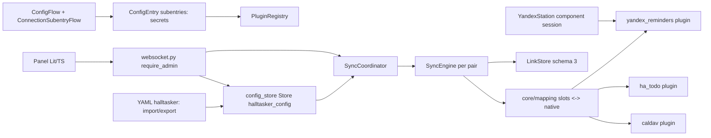

# HAlltasker — architecture v2 (draft 2.0, 2026-11-01)

> Language: English only (agent-facing, binding). There is no Russian reading copy yet; the owner maintains `docs/ru/`.

This document describes **how** [docs/v2/SPEC.md](SPEC.md) is implemented. The signatures and data structures here are binding for v2 issues. Until the owner starts the v2 implementation, [docs/ARCHITECTURE.md](../ARCHITECTURE.md) (v1.3) stays binding for every open v1 issue. Sections of v1.3 are cited as "v1.3 §N". Changes against v1.3 and the FR → section table are in §17.

## 1. Overview

```
Home Assistant
│
├── panel "HAlltasker" (Lit + TypeScript bundle, admin only)        §13
│        │ websocket halltasker/*                                   §9
│        ▼
custom_components/halltasker
├── __init__.py        async_setup: YAML import (§8), panel, websocket, services; async_setup_entry: stores, registry, coordinator
├── config_flow.py     HAlltaskerConfigFlow (single entry) + ConnectionSubentryFlow (credentials per connection)  §7
├── websocket.py       halltasker/* commands, all @require_admin                                                §9
├── panel.py           static path + panel_custom registration                                                  §13
├── yaml_io.py         halltasker: section ↔ ConfigDocument; export with !secret                               §8
├── coordinator.py     timers, events, one global lock, chained runs; pairs from the config store              §10
├── sensor.py, diagnostics.py, services.yaml, strings.json, translations/{en,ru}.json, manifest.json        §12
├── core/                                   (no homeassistant imports)
│   ├── model.py         FieldSpec, ItemSchema, CanonicalItem, Capabilities, Snapshot, Link,
│   │                    Connection, Container, Node, ValueMap, FieldMap, Pair, DirectionRule, CanonicalTask facade  §2, §3
│   ├── config_store.py  ConfigDocument, validation, (de)serialization over a duck-typed storage                     §2, §7
│   ├── schema_builder.py prefill by role, type compatibility, default value maps, mapping warnings                  §2, §5
│   ├── mapping.py       schema_for, to_slots, to_native, caps_for_slots                                            §5
│   ├── downgrade.py     per-field downgrade and equivalence                                                         §5
│   ├── diff.py, conflict.py, router.py, matching.py, actions.py   as v1.3, generalized to ItemSchema               §6
│   ├── engine.py        SyncEngine.run_pair over two NodePorts                                                      §6
│   └── link_store.py    LinkStore / PairLinks, schema 3                                                             §11
├── plugins/
│   ├── base.py          PluginDescriptor, Plugin, AuthFailed, NodeUnavailable                                      §4
│   ├── registry.py      PluginRegistry, BoundNode (plugin + node + secrets → NodePort)                              §4
│   ├── ha_todo.py       todo.* entities                                                                             §4a
│   ├── caldav.py        CalDAV accounts (caldav library, executor)                                                  §4b
│   └── yandex_reminders.py  Alice reminders over the YandexStation session                                          §4c
└── frontend/            halltasker-panel.js (built bundle, committed)                                               §13
frontend/                Lit + TypeScript sources, package.json, rollup config (repository root, not shipped)        §13
```

Topology inside a pair is still a "star": a plugin knows only its own native fields; `core/mapping.py` translates native fields to the pair's slots and back. Plugins never see another plugin and never see a pair. The core never sees credentials: plugins receive them through `BoundNode` (§4), which lives outside `core/`.



## 2. Config model (`core/model.py`, `core/config_store.py`)

All structures are `dataclasses`, immutable (`frozen=True`), with explicit serialization to JSON-compatible dicts (`to_dict()` / `from_dict()`), no HA imports. Ids are `uuid4().hex`, generated by the core (`config_store.new_id()`), never edited by the user.

```python
@dataclass(frozen=True)
class Connection:
    id: str; name: str; plugin_id: str
    settings: Mapping[str, Any] = field(default_factory=dict)   # non-secret; e.g. yandex_station entry id for yandex_reminders
    interval: int = 300

@dataclass(frozen=True)
class Container:
    id: str; name: str; path: str | None = None; query: str | None = None

@dataclass(frozen=True)
class Node:
    id: str; name: str; connection_id: str; container: Container; kind: str = "task"

@dataclass(frozen=True)
class ValueMap:
    read: Mapping[str, str]            # native value -> canonical value
    write: Mapping[str, str]           # canonical value -> native value
    default: str | None = None

@dataclass(frozen=True)
class FieldMap:
    slot: str
    a: str | None                      # native field of node A; None = dropped
    b: str | None
    prefer: Literal["pair", "a", "b"] = "pair"
    value_map_a: ValueMap | None = None
    value_map_b: ValueMap | None = None

@dataclass(frozen=True)
class Pair:
    id: str; name: str; a: str; b: str                 # node ids
    mapping: tuple[FieldMap, ...]
    direction: Literal["both", "a_to_b", "b_to_a"] = "both"   # preset; expands to DirectionRule pair
    interval: int = 60; conflict: Literal["prefer_a", "prefer_b"] = "prefer_a"
    initial_sync: Literal["merge", "dry_run"] = "merge"; enabled: bool = True
    a_to_b: DirectionRule = DirectionRule(); b_to_a: DirectionRule = DirectionRule()
```

`mapping` has no default and therefore stands before `direction`: a dataclass field without a default cannot follow fields with defaults.

`DirectionRule`, `Filter`, `Transform`, `DeletePolicy` are unchanged from v1.3 §2 (including `Filter.require_due: bool | Literal["datetime"]` and `DirectionRule.delete_past_due`). `Filter.title_regex` and `Filter.require_due` read the slots `title` and `due`; `Transform` writes them.

`Connection.interval`: seconds, minimum 15; `caldav` minimum 60. The effective scheduling interval of a pair is `max(pair.interval, conn_a.interval, conn_b.interval)` (SPEC FR-1.8). Plugin defaults come from `PluginDescriptor.default_interval` (§4).

```python
# core/router.py
def effective_rule(pair: Pair, direction: Literal["a_to_b", "b_to_a"]) -> DirectionRule:
    # direction preset "both" -> the stored rule
    # preset "a_to_b" and direction "b_to_a" (or the reverse) -> DirectionRule(create=False, update=False,
    #     complete=False, delete="false", delete_past_due=True, filter=Filter(), transform=Transform())
    # otherwise -> the stored rule
```

The engine (§6) reads rules only through `effective_rule`; the stored rules of the switched-off direction are kept so that switching the preset back restores them.

```python
# core/config_store.py
@dataclass(frozen=True)
class ConfigDocument:
    connections: tuple[Connection, ...] = ()
    nodes: tuple[Node, ...] = ()
    pairs: tuple[Pair, ...] = ()
    def to_dict(self) -> dict[str, Any]: ...        # {"schema": 1, "connections": [...], "nodes": [...], "pairs": [...]}
    @classmethod
    def from_dict(cls, data: Mapping[str, Any]) -> "ConfigDocument": ...

@dataclass(frozen=True)
class ConfigError:
    path: str          # e.g. "pairs[yandex_icloud].mapping[status].value_map_a"
    message: str

def new_id() -> str                                                     # uuid4().hex
def validate(doc: ConfigDocument, descriptors: Mapping[str, PluginDescriptor],
             node_fields: Mapping[str, tuple[FieldSpec, ...]]) -> list[ConfigError]
    # node_fields: node id -> the node's FieldSpecs (from the plugin, §4); a node missing here is not checked for fields
def links_to_reset(old: ConfigDocument, new: ConfigDocument) -> frozenset[str]   # pair ids, SPEC FR-2.5
```

Validation rules (`validate`; an empty list = valid; any error rejects the whole document, SPEC FR-8.4):

1. `id` values are unique per kind; `name` values are unique per kind and non-empty.
2. Every `Node.connection_id` names an existing connection; every `Connection.plugin_id` is a registered plugin; `Node.kind` is in the plugin's kinds (`"task"` in v2).
3. Every `Pair.a` / `Pair.b` names an existing node; `a != b`; no two pairs connect the same two nodes (either order).
4. **Forest:** union-find over the pairs in document order; a pair whose two nodes already share a root → `ConfigError(f"pairs[{name}]", "pairs form a cycle")` (v1.3 §7 rule 4).
5. `pair.interval >= 15`; `connection.interval >= 15` (`>= 60` for `caldav`).
6. Mapping: slot names unique in the pair and matching `[a-z][a-z0-9_]*`; the slot `title` exists with both sides set; a native field is used at most once per side; every set side names a field of that node's `FieldSpec`s that is readable.
7. Type compatibility of a row with both sides set (`schema_builder.compatible(spec_a, spec_b)`): equal types; or `str`/`text` (slot type `text`); or `due`/`datetime` (slot type `due`). Anything else is an error.
8. Enum rows: the slot's canonical values are `("open", "done")` for the slot `status`; for another enum slot, the native values of side A, mapped through `value_map_a.read` when present. A side whose native values (mapped through its `read`) are not exactly the canonical values needs a value map; `read` must map every native value; `write` must map every canonical value to a native value the field accepts; `default`, when set, is a canonical value. A value map on a non-enum row is an error.
9. A `due` slot mapped to a `datetime` field on side Y requires `filter.require_due: "datetime"` in the effective rule toward Y (the v1.3 §7 rule 8, generalized to any plugin).
10. Direction rules: `filter.title_regex` is a valid regex; a rule with `filter.require_due` true or a `transform.due` other than `keep` requires a `due` slot; `transform.title_prefix` requires a writable `title` on the target.
11. A connection is referenced by a node → it cannot be absent from the document (this is how "delete is refused", SPEC FR-1.6, is enforced on save).

`links_to_reset(old, new)` returns the ids of pairs that exist in both documents and whose node set changed, or one of whose nodes changed `connection_id` or `container.id`/`container.path`. The websocket save (§9) resets their namespaces after the confirmation flag is set (SPEC FR-2.5). A rename never appears here.

## 3. Item model (`core/model.py`)

```python
FieldType = Literal["str", "text", "enum", "due", "datetime", "int", "str_list"]
FieldCap = Literal["none", "partial", "full"]      # due: partial = date only

@dataclass(frozen=True)
class FieldSpec:
    name: str                 # native field name as the plugin names it
    type: FieldType
    role: str | None = None   # suggested slot: title, description, status, due, priority, tags
    read: bool = True
    write: bool = True
    values: tuple[str, ...] = ()   # enum only

@dataclass(frozen=True)
class ItemSchema:             # built per pair from the mapping, not global
    kind: str                 # "task"
    fields: tuple[FieldSpec, ...]      # one per mapped slot, named by slot
    match_key: tuple[str, ...] = ("title", "due")

@dataclass(frozen=True)
class CanonicalItem:
    kind: str
    fields: Mapping[str, Any]          # slot (core) or native name (plugin boundary)

@dataclass(frozen=True)
class Capabilities:
    create: bool; update: bool; delete: bool
    fields: Mapping[str, FieldCap]     # by native field name
```

Rules:

- `ItemSchema.match_key` keeps only the slots of `("title", "due")` that the schema has; `title` is always present (§2 rule 6).
- `CanonicalItem.fields` holds a value for every field of the schema it was built for; an absent value is `None`. `__post_init__` freezes `fields` into a `MappingProxyType` over a copy and checks types per the schema when converted (`mapping.to_slots`); a `datetime` without `tzinfo` → `ValueError` (v1.3 §2 invariant).
- `Capabilities.fields` is keyed by native name at the plugin boundary and by slot after `mapping.caps_for_slots` (§5). A field absent from `fields` is `none`. `partial` is defined for `due` only (date only, the v1.3 `caps.due == "date"`); for other types `partial` is treated as `full`.

Value serialization per type (`model.serialize_value(type, value)` / `parse_value(type, raw)`):

| Type | Python value | JSON |
|---|---|---|
| `str`, `text`, `enum` | `str \| None` | string or `null` |
| `due` | `dt.date \| dt.datetime \| None` | `"YYYY-MM-DD"` or ISO 8601 with offset; parsing as v1.3 §2 (10 characters without `T` = date; naive datetime = error) |
| `datetime` | `dt.datetime \| None` (tz-aware) | ISO 8601 with offset |
| `int` | `int \| None` | number or `null` |
| `str_list` | `tuple[str, ...]` | list of strings, **sorted and deduplicated** (compared as a set) |

```python
@dataclass(frozen=True)
class Snapshot:
    data: dict[str, Any]       # CanonicalItem.to_dict(schema) = {"kind": ..., "fields": {slot: serialized}}
    hash: str                  # sha256 of the canonical JSON (sort_keys=True, separators=(",", ":"))
    @classmethod
    def of(cls, item: CanonicalItem, schema: ItemSchema) -> "Snapshot": ...
    def item(self, schema: ItemSchema) -> CanonicalItem: ...   # slots missing in data -> None
```

`Link` is unchanged from v1.3 §2 except that `node` holds the **node uuid** and the snapshots hold slot data.

**`CanonicalTask` facade.** `CanonicalTask`, `FIELDS` and `TASK_SCHEMA` stay in `core/model.py` for the v1 tests and the `ha_todo` regression:

```python
TASK_SCHEMA = ItemSchema(kind="task", fields=(
    FieldSpec("title", "str", role="title"), FieldSpec("description", "text", role="description"),
    FieldSpec("status", "enum", role="status", values=("open", "done")), FieldSpec("due", "due", role="due")))

@dataclass(frozen=True)
class CanonicalTask:          # v1.3 §2, unchanged fields
    ...
    def to_item(self) -> CanonicalItem: ...                     # kind "task", fields of TASK_SCHEMA
    @classmethod
    def from_item(cls, item: CanonicalItem) -> "CanonicalTask": ...
```

## 4. Plugin contract v2 (`plugins/base.py`, `plugins/registry.py`)

`plugins/base.py` does not import `homeassistant` (the engine imports its exceptions, as in v1.3). Concrete plugins may import HA; each is constructed once with `hass` and serves every connection of its plugin id, keeping per-connection state (clients, retention stores) keyed by `connection.id`.

```python
@dataclass(frozen=True)
class PluginDescriptor:
    plugin_id: str; name: str
    credentials_schema: Mapping[str, Any]   # JSON-schema-like dict rendered by the panel; {} when credential_kind == "none"
    settings_schema: Mapping[str, Any]
    fields: tuple[FieldSpec, ...]
    credential_kind: Literal["none", "basic", "token"]   # none = built-in connection, no own credentials (ha_todo, yandex_reminders)
    default_interval: int = 300
    kinds: tuple[str, ...] = ("task",)
    default_value_maps: Mapping[str, ValueMap] = field(default_factory=dict)   # native enum field -> map to open/done
    single_connection: bool = False         # ha_todo: exactly one built-in connection, created automatically

class Plugin(ABC):
    descriptor: PluginDescriptor
    async def validate(self, connection: Connection, secrets: Mapping[str, str]) -> None      # AuthFailed | NodeUnavailable
    async def containers(self, connection: Connection, secrets) -> list[Container]            # discovery
    async def capabilities(self, node: Node, secrets) -> Capabilities
    async def list(self, node: Node, secrets) -> dict[str, CanonicalItem]              # native field names
    async def create(self, node, item: CanonicalItem, known_ids: frozenset[str], secrets) -> str
    async def update(self, node, external_id: str, item: CanonicalItem, changed: frozenset[str], secrets) -> None
    async def delete(self, node, external_id: str, secrets) -> None
    # reserved, not implemented in v2: async def create_container(...)

class AuthFailed(Exception): ...
class NodeUnavailable(Exception): ...
class DependencyUnavailable(NodeUnavailable):        # another HA component the plugin relies on is missing
    def __init__(self, domain: str, message: str) -> None: ...   # .domain, e.g. "yandex_station"
```

The four descriptor fields after `credential_kind` and `DependencyUnavailable` extend the minimal contract; everything else is binding as listed.

Contract rules:

- `list` returns the **full** container: `external_id -> CanonicalItem` with native field names and `kind = node.kind`; any error raises `NodeUnavailable` (or `AuthFailed`); a partial result is forbidden (v1.3 §3).
- `create`, `update`, `delete` receive native names and an item that the core has already **downgraded** and translated (§5); `update` writes only the native fields in `changed`. The plugin makes no sync decisions and never sees slots, pairs or other plugins.
- `containers` returns only containers that exist now. `capabilities(node)` raises `NodeUnavailable("container not found")` when the node's container no longer resolves (SPEC FR-2.6).
- `validate` is called before a connection is saved and on reconfigure (§7). Built-in connections are validated too (`yandex_reminders` checks that the YandexStation entry exists).
- `secrets` is `{}` for `credential_kind == "none"`. A plugin never logs, stores or returns secrets.
- Schema dicts (`credentials_schema`, `settings_schema`) map a key to `{"type": "string" | "boolean" | "integer" | "url", "required": bool, "default": Any, "secret": bool}`; `secret: true` keys are rendered as password inputs, never returned by websocket commands and exported as `!secret` (§8).

```python
# plugins/registry.py
SecretsProvider = Callable[[str], Mapping[str, Any]]      # connection id -> subentry data ({} for built-in connections)

class PluginRegistry:
    def __init__(self, plugins: Iterable[Plugin]) -> None: ...
    def get(self, plugin_id: str) -> Plugin                 # KeyError for an unknown id
    def descriptors(self) -> dict[str, PluginDescriptor]
    def bind(self, node: Node, connection: Connection, secrets: SecretsProvider) -> "BoundNode"

class BoundNode:                                            # implements core.engine.NodePort
    node_id: str
    # fields() -> plugin.descriptor.fields; the other methods call the plugin with (node, ..., secrets(connection.id)),
    # reading the secrets on every call so that a reconfigured connection takes effect without a restart
```

**Capability matrix** (native field → `FieldCap`, operations; `R` = read-only):

| Plugin | title | description | status | due | priority | tags | other | create / update / delete |
|---|---|---|---|---|---|---|---|---|
| `ha_todo` | `summary` full | `description` full if feature 64, else none | `status` full | `due`: full if feature 32, partial if 16 only, else none | — | — | — | features 1 / 4 / 2 |
| `caldav` | `SUMMARY` full | `DESCRIPTION` full | `STATUS` full | `DUE` full | `PRIORITY` full | `CATEGORIES` full | `COMPLETED` R | yes / yes / yes |
| `yandex_reminders` | `text` full | — | `status` full (cancel only, §4c) | `due` full (`datetime` type) | — | — | — | yes / yes / yes |

**Default value maps** (prefilled by `schema_builder.prefill` for the slot `status`, canonical `open | done`):

| Plugin, field | `read` (native → canonical) | `write` (canonical → native) | `default` |
|---|---|---|---|
| `ha_todo.status` | `needs_action → open`, `completed → done` | `open → needs_action`, `done → completed` | `open` |
| `caldav.STATUS` | `NEEDS-ACTION → open`, `IN-PROCESS → open`, `COMPLETED → done`, `CANCELLED → done` | `open → NEEDS-ACTION`, `done → COMPLETED` | `open` |
| `yandex_reminders.status` | `active → open`, `cancelled → done` | `open → active`, `done → cancelled` | `open` |

With these maps a CalDAV item in `IN-PROCESS` reads as `open`; it is rewritten to `NEEDS-ACTION` only if the `status` slot is written to it (a change from the other side), never by itself, because an unchanged canonical value is not a change.

**Future plugins with their own client** (`jira`, `yandex_tracker`; SPEC FR-13.4): a module in `plugins/`, a `Plugin` subclass registered in `__init__.py`; `credential_kind` `basic` or `token` with credentials only in the connection subentry; discovery returns projects as `Container(id, name, query=...)`; native fields with roles and `values` for enums (workflow statuses), so that the panel can build the value map; no import of the plugin from `core/`.

## 4a. Plugin `ha_todo` (`plugins/ha_todo.py`)

The v1.3 §4 plugin, moved to the v2 contract. Descriptor: `plugin_id = "ha_todo"`, `credential_kind = "none"`, `credentials_schema = {}`, `settings_schema = {}`, `default_interval = 15`, `single_connection = True`. The built-in connection is created by `async_setup_entry` when the config store has no `ha_todo` connection (§7).

Fields:

```python
FIELDS = (FieldSpec("summary", "str", role="title"),
          FieldSpec("description", "text", role="description"),
          FieldSpec("status", "enum", role="status", values=("needs_action", "completed")),
          FieldSpec("due", "due", role="due"))
```

- `containers`: every state of the `todo` domain (`hass.states.async_all("todo")`) as `Container(id=entity_id, name=friendly_name or entity_id)`.
- `capabilities(node)`: from `supported_features` of `node.container.id` per the matrix in §4; `NodeUnavailable` per v1.3 §4 (state missing, `unavailable`, `unknown`).
- `list`, `create`, `update`, `delete`: the HA API facts of v1.3 §4 apply unchanged (services `todo.get_items` / `add_item` / `update_item` / `remove_item`, `blocking=True`, `ServiceValidationError` on unsupported fields, the `completed` attribute ignored), with native names instead of `CanonicalTask` fields: `summary` ↔ `item`/`rename`, `status`, `due` ↔ `due_date`/`due_datetime`, `description`.
- `create`: the uid lookup of v1.3 §4 with `known_ids` (match on the native item with `status` forced to `needs_action`; then `update_item(status)` for a completed item; 3 attempts, 1 s apart; `NodeUnavailable("created item not found")`).
- `validate`: no-op.

## 4b. Plugin `caldav` (`plugins/caldav.py`)

The client knowledge of v1.3 §4a, moved from a `todo` platform into a plugin; no HA entity is created. Descriptor: `plugin_id = "caldav"`, `credential_kind = "basic"`, `default_interval = 300` (minimum 60, §2 rule 5), `settings_schema = {}`,

```python
credentials_schema = {
    "url": {"type": "url", "required": True},
    "username": {"type": "string", "required": True},
    "password": {"type": "string", "required": True, "secret": True},
    "verify_ssl": {"type": "boolean", "required": False, "default": True},
}
FIELDS = (FieldSpec("SUMMARY", "str", role="title"),
          FieldSpec("DESCRIPTION", "text", role="description"),
          FieldSpec("STATUS", "enum", role="status",
                    values=("NEEDS-ACTION", "IN-PROCESS", "COMPLETED", "CANCELLED")),
          FieldSpec("DUE", "due", role="due"),
          FieldSpec("PRIORITY", "int", role="priority"),
          FieldSpec("CATEGORIES", "str_list", role="tags"),
          FieldSpec("COMPLETED", "datetime", write=False))
```

HA facts (checked in the installed HA 2026.9.4, `homeassistant/components/caldav/{__init__.py,api.py,manifest.json}`):

| What | How |
|---|---|
| Client | `caldav.DAVClient(url, username=..., password=..., ssl_verify_cert=verify_ssl, timeout=...)`; `client.principal()` performs the login |
| Auth error | `caldav.lib.error.AuthorizationError` with `err.reason == "Unauthorized"` → credentials error; other reasons = wrong URL or unexpected server answer |
| Transport errors | `requests.Timeout`, `requests.ConnectionError`, `caldav.lib.error.DAVError` |
| Collections with VTODO | `client.principal().calendars()`, then `calendar.get_supported_components()`; `KeyError`/`DAVError` from it means the server does not report components, and HA assumes `VTODO` is supported |
| Library pins | `caldav==2.1.0`, `icalendar==6.3.1`, `vobject==0.9.9` (the manifest of HA core `caldav`) |

All `caldav` calls are synchronous and run through `hass.async_add_executor_job`. The module imports the library as `import caldav` (absolute import; the plugin module name does not shadow it). One `DAVClient` per connection is cached together with a hash of the secrets it was built from and rebuilt when they change.

- `validate`: build a client and call `principal()`; `AuthorizationError("Unauthorized")` → `AuthFailed`; other `AuthorizationError`, transport errors → `NodeUnavailable`.
- `containers`: the collections as above (assume VTODO when not reported, as HA does) → `Container(id=<URL path of the collection>, name=calendar.name or the path, path=str(calendar.url))`. `Container.id` is the identity (SPEC FR-2.3); `path` is the absolute URL used to open the collection without a new discovery.
- `list`: open the collection by `path` (fallback: discovery by `id`; not found → `NodeUnavailable("container not found")`); `calendar.search(todo=True, include_completed=True)`; each `icalendar_component` → native item by `read_vtodo` (below); a VTODO without `UID` or `SUMMARY` is skipped.
- `create`: the plugin generates the `UID` (`uuid4().hex`), builds the VTODO with `write_vtodo` and saves it in the collection; returns the `UID`, so no lookup is needed and `known_ids` is unused. The exact `save_todo` call shape is confirmed against `caldav==2.1.0` in the plugin issue (v1.3 §4a used `calendar.save_todo(**kwargs)`).
- `update`: `calendar.todo_by_uid(uid)` → `write_vtodo(component, item, changed, now)` → `todo.save(no_create=True, obj_type="todo")`; `NotFoundError` → `NodeUnavailable`.
- `delete`: `todo_by_uid(uid).delete()`.
- Transport errors in any call → `NodeUnavailable`; `AuthorizationError("Unauthorized")` → `AuthFailed`.

```python
def read_vtodo(vtodo: icalendar.Todo, tz: dt.tzinfo) -> dict[str, Any] | None                     # pure
def write_vtodo(vtodo: icalendar.Todo, fields: Mapping[str, Any], changed: frozenset[str],
                now: dt.datetime) -> None                                                    # pure, mutates
```

RFC 5545 mapping (moved from v1.3 §4a, now per native field):

| Native field | Read | Write |
|---|---|---|
| `SUMMARY`, `DESCRIPTION` | text; missing `DESCRIPTION` → `None` | set; `None` removes `DESCRIPTION` |
| `STATUS` | the `STATUS` value when present; without `STATUS`: `COMPLETED` present or `PERCENT-COMPLETE == 100` → `"COMPLETED"`, otherwise `"NEEDS-ACTION"` | `COMPLETED` → `STATUS:COMPLETED`, `PERCENT-COMPLETE:100`, `COMPLETED:<now UTC>` only if absent; `NEEDS-ACTION` → `STATUS:NEEDS-ACTION`, remove `COMPLETED` and `PERCENT-COMPLETE`; `IN-PROCESS` → `STATUS:IN-PROCESS`, remove `COMPLETED`; `CANCELLED` → `STATUS:CANCELLED` |
| `DUE` | `date` for `VALUE=DATE`; a datetime as tz-aware (floating time → `tz`) | `VALUE=DATE` for a `date`, tz-aware datetime otherwise; `None` removes `DUE` |
| `PRIORITY` | `1..9` → int; `0` or missing → `None` | int `1..9`; `None` removes `PRIORITY` |
| `CATEGORIES` | all `CATEGORIES` properties merged into one list | one `CATEGORIES` property with the values; empty removes it |
| `COMPLETED` | tz-aware datetime or `None` | never written by the core (read-only) |

A VTODO without `DTSTAMP` (Yandex) is accepted on read and gets `DTSTAMP` on write (v1.3 §4a). Manifest `requirements` = the three pins above; `requirements_dev.txt` gets the same lines (as v1.2).

## 4c. Plugin `yandex_reminders` (`plugins/yandex_reminders.py`)

The client knowledge of v1.3 §4b, moved from a `todo` platform into a plugin; no HA entity is created. HAlltasker has no credentials for Yandex: the plugin uses the live session of the installed YandexStation component.

Descriptor: `plugin_id = "yandex_reminders"`, `credential_kind = "none"`, `credentials_schema = {}`, `default_interval = 60` (minimum 30, as v1.4 FR-14.1),

```python
settings_schema = {
    "yandex_station_entry": {"type": "string", "required": False},   # YandexStation entry unique_id; required when there are several
    "device": {"type": "string", "required": False},                 # speaker name or quasar device_id for reminders created from HA
    "push": {"type": "boolean", "required": False, "default": False},
}
FIELDS = (FieldSpec("text", "str", role="title"),
          FieldSpec("due", "datetime", role="due"),
          FieldSpec("status", "enum", role="status", values=("active", "cancelled")))
```

**Session provider** (facts of v1.3 §4b, unchanged; YandexStation sources, master 2026-11-01): `hass.data["yandex_station"][<entry unique_id>]` is a `YandexQuasar` whose `.session` is a `YandexSession` (`async post(url, json=..., headers=...)`, own CSRF handling and one retry after 401, raises `Exception("<url> return <status> status")` when retries are exhausted); `hass.data["yandex_station"]["speakers"]` = `{device_id: device}` with `device["quasar_info"]["device_id"]` and `device["name"]`. Nothing is imported from `custom_components.yandex_station`; the lookup is lazy on every call. `ALARM_HEADERS`, `RPC`, `_ENDPOINTS` (write endpoints `None` until stage 1), `get_reminders`, `create_reminder`, `update_reminder`, `cancel_reminder`, `reminder_body` keep their v1.3 §4b signatures; `resolve_session(hass, connection)` and `resolve_device(hass, connection)` take the connection settings instead of `RemindersNode`.

- Built-in connection: no subentry; the owner creates the connection in the panel and may set the settings above. No manifest dependency on `yandex_station` (hassfest cannot validate a custom domain).
- `validate` and every other call: YandexStation data missing, the entry missing, or several entries without `yandex_station_entry` → `DependencyUnavailable("yandex_station", ...)`. Session failures (`Exception` from the session, `aiohttp.ClientError`, `KeyError`, `ValueError`) → `NodeUnavailable`. HAlltasker never raises `AuthFailed` here: an expired session is repaired in YandexStation.
- `containers`: one `Container(id="reminders", name="Alice reminders")`.
- `capabilities`: create/update/delete true; fields per §4.
- `list`: `get_reminders` → single-trigger reminders as `{"text": text, "due": datetime(tz=HA zone), "status": "active"}` keyed by reminder `id` (recurring and malformed ones skipped, v1.3 §4b mapping), plus the retained items (below) as `status: "cancelled"`.
- **Retention**: `Store(hass, 1, f"halltasker_reminders_{connection.id}")` with `{"retained": {id: {"text": ..., "due": iso, "cancelled_at": iso}}}`. An item cancelled through `status: cancelled` is written there before the API call; retained items absent from the API answer are listed as `cancelled` until `due + 1 day < now`, then dropped; a retained id that reappears in the API answer is dropped from the store (v1.3 §4b, v1.4 FR-14.5). The store is plugin state, not configuration and not link data.
- `create`: `due` must be a datetime (§2 rule 9 guarantees it); `create_reminder(session, text, due, resolve_device(...), push)` → the reminder id.
- `update`: `status` `active → cancelled` → retain + `cancel_reminder`; `status` `cancelled → active` → `NodeUnavailable("cannot reopen a cancelled reminder")` (recorded as a failed action); `text`/`due` → `update_reminder` (until stage 1: endpoint `None` → `NodeUnavailable("not supported")`, and the pair should set `update: false` toward the node).
- `delete`: `cancel_reminder` (a retained id is only dropped from the store).

## 5. Mapping and downgrade (`core/mapping.py`, `core/schema_builder.py`, `core/downgrade.py`)

```python
# core/mapping.py (pure)
def schema_for(pair: Pair, fields_a: tuple[FieldSpec, ...], fields_b: tuple[FieldSpec, ...]) -> ItemSchema
def to_slots(item: CanonicalItem, side: Literal["a", "b"], pair: Pair) -> CanonicalItem       # rename + value_map.read
def to_native(item: CanonicalItem, side, pair, changed: frozenset[str]) -> tuple[CanonicalItem, frozenset[str]]
def caps_for_slots(caps: Capabilities, side, pair) -> Capabilities
```

- `schema_for`: one slot `FieldSpec` per row whose two sides are set, in mapping order. Slot type per §2 rule 7 (`due` wins over `datetime`, `text` over `str`); `values` per §2 rule 8; `read` = both native fields readable; `write` = at least one native field writable; `role` = the slot name when it is a known role. Rows with one side dropped are not in the schema. `match_key` per §3.
- `to_slots`: for every schema slot, takes the native field of `side`; enum values go through `value_map_<side>.read` (missing value → `default`; no default → the value is kept and the item is logged at `DEBUG`); returns an item with slot names. Native fields not in the schema are discarded.
- `to_native`: the reverse for the target side: renames slots to native fields, applies `value_map_<side>.write`, drops slots whose native field on `side` is not writable; returns the native item and the native names of `changed`.
- `caps_for_slots`: keeps `create`/`update`/`delete`; slot capability = native capability of the side's field; a non-writable native field → `none` for writing; a slot whose side is a `datetime` field gets `full` (dates are kept out by §2 rule 9).

```python
# core/schema_builder.py (pure, used by validation and by the panel through websocket)
def prefill(fields_a: tuple[FieldSpec, ...], fields_b: tuple[FieldSpec, ...],
            defaults: Mapping[tuple[str, str], ValueMap]) -> tuple[FieldMap, ...]
    # one row per role present on both sides (slot = role), with default value maps where needed;
    # rows for fields without a counterpart are not created
def compatible(a: FieldSpec, b: FieldSpec) -> FieldType | None    # slot type or None
def warnings(pair: Pair, fields_a: tuple[FieldSpec, ...], fields_b: tuple[FieldSpec, ...]) -> list[str]
    # "field X of node A is not synchronized", "slot priority dropped: not provided by node B" (SPEC FR-4.7)
```

`defaults` is keyed by `(plugin_id, native field name)` and comes from the plugins' `default_value_maps` (§4).

```python
# core/downgrade.py
def downgrade(item: CanonicalItem, caps: Capabilities, schema: ItemSchema, tz: dt.tzinfo) -> CanonicalItem:
    # for each schema slot:
    #   caps.fields.get(slot, "none") == "none"            -> None
    #   type "due", value is datetime, cap == "partial"     -> value.astimezone(tz).date()
    #   otherwise                                           -> unchanged
def equivalent(observed: CanonicalItem, expected: CanonicalItem, caps: Capabilities,
               schema: ItemSchema, tz: dt.tzinfo) -> bool:
    return Snapshot.of(observed, schema).hash == Snapshot.of(downgrade(expected, caps, schema, tz), schema).hash
```

`tz` is derived as in v1.3 §5. The `due: date_only` transform is applied before the downgrade (v1.3 §5).

## 6. Engine deltas (`core/engine.py`)

The algorithm of v1.3 §6 is kept step by step. This section lists only what changes.

```python
class NodePort(Protocol):                       # core/engine.py; implemented by plugins.registry.BoundNode
    node_id: str
    async def fields(self) -> tuple[FieldSpec, ...]: ...
    async def capabilities(self) -> Capabilities: ...                       # native names
    async def list(self) -> dict[str, CanonicalItem]: ...                   # native names
    async def create(self, item: CanonicalItem, known_ids: frozenset[str]) -> str: ...
    async def update(self, external_id: str, item: CanonicalItem, changed: frozenset[str]) -> None: ...
    async def delete(self, external_id: str) -> None: ...

class SyncEngine:
    def __init__(self, store: PairLinks, ports: Callable[[str], NodePort],
                 clock: Callable[[], dt.datetime]): ...
    async def run_pair(self, pair: Pair, *, dry_run: bool) -> RunResult: ...
```

`ports(node_id)` replaces `registry.for_node(node)`; the coordinator passes a function that binds plugin, node and secrets (§4, §10). `RunResult` keeps the v1.3 §6.1 step 9 fields and gains two: `error_kind: Literal["auth", "dependency", "unavailable", "other"] | None = None` and `error_ref: str | None = None`. `run_pair` maps `AuthFailed` → `("auth", connection id)`, `DependencyUnavailable` → `("dependency", its domain)`, any other `NodeUnavailable` → `("unavailable", node id)`, any other exception → `("other", None)`. The coordinator uses them for repairs issues (§10).

| v1.3 §6.1 step | v2 |
|---|---|
| 1. Plugins and capabilities | `pa, pb = ports(pair.a), ports(pair.b)`; `fields_a = await pa.fields()`, `fields_b`; `schema = mapping.schema_for(pair, fields_a, fields_b)`; `caps_a = mapping.caps_for_slots(await pa.capabilities(), "a", pair)`, `caps_b` likewise; `rule_ab = router.effective_rule(pair, "a_to_b")`, `rule_ba`. From here on everything is in slots |
| 2. Full read | `snap_a = {eid: mapping.to_slots(it, "a", pair) for eid, it in (await pa.list()).items()}`, `snap_b` likewise |
| 3, 3a. Link state, new items | unchanged (node strings → node uuids) |
| 4. Classification | `classify(link, current, caps, schema, tz)`; `changed_fields = {slot for slot in schema slots if current[slot] != last_synced[slot]}` with the downgrade for `due`. A slot absent from `last_synced` (a slot added to the mapping later) counts as changed; on both sides it is an overlap and resolves by `prefer` in one cycle |
| 5. Decision | table unchanged. `conflict.merge(a, changed_a, b, changed_b, schema, prefer_for)` with `prefer_for = lambda slot: row.prefer if row.prefer != "pair" else ("a" if pair.conflict == "prefer_a" else "b")`; `router.allowed` unchanged; `op_for_change(changed)` unchanged: `{"status"}` alone is `complete`; a schema without `status` never produces `complete` or `soft_delete` (`soft_delete` toward a side without a writable `status` slot is gated like an off capability, SPEC FR-7.2) |
| 5. Orphan matching | `matching.find_match(expected, new_X, caps_present, caps_X, schema, tz)`; key = `schema.match_key`; the orphan-update `changed` is computed over the schema slots |
| 6. New items | `matching.pair_up(new_a, new_b, caps_a, caps_b, schema, tz)` |
| 7. Initial cycle | unchanged |
| 8. Execution | writes go through `mapping.to_native(downgrade(item, caps_X, schema, tz), side_X, pair, changed)` and the port; snapshots are `Snapshot.of(..., schema)` in slots |
| 8a, 9 | unchanged |

```python
# core/conflict.py
def merge(a, changed_a, b, changed_b, schema: ItemSchema, prefer_for: Callable[[str], Literal["a", "b"]]) -> CanonicalItem
    # slots changed on one side only -> from that side; overlapping slots -> from prefer_for(slot); others -> a
```

`core/router.py`: `passes_filter(rule, item)` and `apply_transform(rule, item, tz)` read and write the slots `title` and `due` of a `CanonicalItem` (a missing slot = the filter condition on it is false and the transform on it is a no-op); `allowed`, `op_for_change`, `effective_delete` are unchanged. v1.3 §6.2 (Delete) and §6.3 (Actions) are unchanged, except that `Action.node` holds the node uuid and `Action.task` holds a `CanonicalItem` in slots.

## 7. Configuration store and ConfigEntry (`core/config_store.py`, `config_flow.py`)

HA facts (checked in the installed HA 2026.9.4 with `.venv/bin/python` and `inspect.signature`):

| What | How |
|---|---|
| Subentry flow types | `ConfigFlow.async_get_supported_subentry_types(config_entry) -> dict[str, type[ConfigSubentryFlow]]` (classmethod on the entry's flow) |
| Subentry | `ConfigSubentry(*, data: MappingProxyType, subentry_id, subentry_type: str, title: str, unique_id: str \| None)`; `entry.subentries` |
| Subentry flow helpers | `ConfigSubentryFlow.async_create_entry`, `async_update_and_abort(entry, subentry, *, unique_id, title, data, data_updates)`, `async_update_reload_and_abort`, `_get_entry()`, `_get_reconfigure_subentry()`, `source` (`SOURCE_USER = "user"`, `SOURCE_RECONFIGURE = "reconfigure"`) |
| Subentry management | `hass.config_entries.async_add_subentry(entry, subentry) -> bool`, `async_update_subentry(entry, subentry, *, data, title, unique_id) -> bool`, `async_remove_subentry(entry, subentry_id) -> bool` |
| Flow REST API used by the panel | `/api/config/config_entries/subentries/flow` and `/api/config/config_entries/subentries/flow/{flow_id}` (`homeassistant/components/config/config_entries.py`) |
| Repairs | `issue_registry.async_create_issue(hass, domain, issue_id, *, is_fixable, severity, translation_key, translation_placeholders=..., data=..., learn_more_url=...)`, `issue_registry.async_delete_issue(hass, domain, issue_id)` |
| Store | `Store(hass, version, key, private=False, *, atomic_writes=False, ...)` |

**Single entry.** `HAlltaskerConfigFlow` keeps the v1 import step (one entry, created from `async_setup`, §8) and gains a `user` step that creates the same single entry when there is no YAML (abort `single_instance_allowed` otherwise). `async_get_supported_subentry_types` returns `{"connection": ConnectionSubentryFlow}`.

**`ConnectionSubentryFlow`** — only for plugins with `credential_kind != "none"`:

- `async_step_user`: choose the plugin (only credential plugins) and the connection name (unique, §2 rule 1); then `async_step_credentials`: a form built from `credentials_schema` (`secret` keys as password selectors); `await plugin.validate(connection, secrets)`; `AuthFailed` → form error `invalid_auth`, `NodeUnavailable` → `cannot_connect`. On success: `async_create_entry(title=name, data={"plugin_id": ..., "secrets": {...}}, unique_id=connection_id)` with `connection_id = config_store.new_id()`, and the connection (without secrets, with `interval = descriptor.default_interval`) is appended to the config store; the entry is then reloaded (§10).
- `async_step_reconfigure`: the same credentials form for `_get_reconfigure_subentry()`; empty `secret` inputs keep the stored values; `validate`; `async_update_and_abort(entry, subentry, data=...)`; the repairs issue of the connection is deleted.
- The panel starts both flows through the subentry flow REST API above with the HA frontend's flow dialog; credential values never pass through `halltasker/*` commands.

The subentry of a connection is found by `subentry.unique_id == connection.id`. `SecretsProvider` (§4) = `lambda cid: dict(sub.data["secrets"])` for that subentry, `{}` for built-in connections.

**Built-in connections** (`credential_kind == "none"`) live only in the config store. `async_setup_entry` adds the `ha_todo` connection (`single_connection`) when it is missing. `yandex_reminders` connections are created by the owner through `halltasker/config/save`.

**Config store.** `Store(hass, 1, "halltasker_config")`; data = `ConfigDocument.to_dict()` (`{"schema": 1, "connections": [...], "nodes": [...], "pairs": [...]}`), never any secret. `core/config_store.py` exports, besides §2:

```python
class ConfigStore:                              # duck-typed storage as LinkStore (v1.3 §9)
    async def load(self) -> ConfigDocument       # None -> empty document; schema != 1 -> WARNING and empty document
    async def save(self, doc: ConfigDocument) -> None
    @property
    def document(self) -> ConfigDocument
    def is_empty(self) -> bool
```

**Consistency between store and subentries**, checked in `async_setup_entry`:

- A credential connection without its subentry (for example, the subentry was deleted in the HA integrations page) stays in the store; its nodes raise `AuthFailed("credentials missing")` through `BoundNode`, and the repairs issue `connection_auth_<connection id>` asks to re-create the credentials from the panel: a new subentry flow started for that connection may reuse its name (the uniqueness check of §2 rule 1 skips a credential connection without a subentry), and the new subentry gets `unique_id = connection.id`.
- A subentry without a connection in the store (created while the store was unavailable) is adopted: a connection with the subentry's `unique_id`, `title` and `plugin_id` is added.
- Saving a document without a credential connection removes its subentry (`async_remove_subentry`) after the store is written (SPEC FR-1.6).

**Repairs issues** (`is_fixable=False`, severity `error` unless noted, translations in `strings.json`):

| `issue_id` | When | Removed |
|---|---|---|
| `connection_auth_<connection id>` | `RunResult.error_kind == "auth"` for a pair of the connection | after the next successful cycle of a pair of the connection, or on reconfigure |
| `dependency_<domain>` | `error_kind == "dependency"` (`yandex_station`); `learn_more_url` = the YandexStation documentation | after the next successful cycle of every affected pair |
| `yaml_ignored` (warning) | a `halltasker:` section at startup while the store is not empty (§8) | when the section is removed or the store is emptied |
| `yaml_invalid` | a `halltasker:` section that fails validation, including a v1 section | after a successful import or when the section is removed |

## 8. YAML import and export (`yaml_io.py`)

Format (SPEC FR-9): the `halltasker:` section of SPEC FR-9.5. Keys:

```yaml
halltasker:
  connections:
    - id: <uuid hex>                # optional on import
      name: yandex1                 # unique, non-empty
      plugin: caldav                # plugin_id
      interval: 300                 # optional, default = plugin default_interval
      settings: {}                  # optional, keys of settings_schema
      credentials: {...}            # keys of credentials_schema; only for credential plugins; secret keys via !secret
  nodes:
    - id: <uuid hex>
      name: yandex1_dela
      connection: yandex1           # connection name
      container: {id: ..., name: ..., path: ..., query: ...}   # as returned by discovery; name/path/query optional
      kind: task                    # optional
  pairs:
    - id: <uuid hex>
      name: yandex_icloud
      a: yandex1_dela               # node names
      b: icloud
      direction: both               # both | a_to_b | b_to_a
      interval: 60
      conflict: prefer_a
      initial_sync: merge
      enabled: true
      mapping:                      # FieldMap rows: slot, a, b (native names or null), prefer, value_map_a, value_map_b
        - {slot: title, a: SUMMARY, b: summary}
      a_to_b: {}                    # v1.3 §7 direction rule keys, unchanged
      b_to_a: {}
```

```python
CONFIG_SCHEMA = vol.Schema({DOMAIN: dict}, extra=vol.ALLOW_EXTRA)    # permissive: a bad section must not fail HA startup

class YamlImportError(Exception):
    errors: list[ConfigError]

def parse_section(conf: Mapping[str, Any], descriptors: Mapping[str, PluginDescriptor]
                  ) -> tuple[ConfigDocument, dict[str, dict[str, Any]]]
    # -> (document, credentials by connection id); resolves names to ids, generates missing ids;
    #    voluptuous shape checks + config_store.validate without node fields; raises YamlImportError.
    #    A v1 section (keys caldav / yandex_reminders, or pairs whose a/b are todo.* strings) -> YamlImportError("v1 format")
def render_section(doc: ConfigDocument, credentials: Mapping[str, Mapping[str, Any]],
                   descriptors: Mapping[str, PluginDescriptor], *, include_secrets: bool) -> tuple[str, str]
    # -> (YAML text of the halltasker: section, secrets.yaml template)
async def async_parse_text(hass, text: str, descriptors) -> tuple[ConfigDocument, dict[str, dict[str, Any]]]
    # homeassistant.util.yaml.parse_yaml(text, Secrets(Path(hass.config.config_dir))) in the executor, then parse_section
```

HA facts (installed 2026.9.4): `homeassistant.util.yaml.parse_yaml(content, secrets: Secrets | None = None)`, `homeassistant.util.yaml.Secrets(config_dir: Path)`; `!secret` in `configuration.yaml` is already resolved by HA before `async_setup` sees the section.

- **Startup import** (`async_setup`, as v1.3 §7 for the entry creation): the raw section is kept in `hass.data[DOMAIN]["yaml"]`; `async_setup_entry` loads the config store, and if it is empty and a section exists: `parse_section` → add subentries for credential connections (`async_add_subentry`) → save the document. If the store is not empty: `yaml_ignored`. On `YamlImportError`: `yaml_invalid` with the first errors in the placeholders; nothing is imported.
- **`halltasker.reload`** (admin service, `async_register_admin_service` as v1.3 §7): `async_integration_yaml_config(hass, DOMAIN)`; store empty and section present → import as above; then `hass.config_entries.async_reload(entry_id)`, which re-reads the store.
- **Panel import** (`halltasker/config/import_yaml`): `async_parse_text` → `config_store.validate` with node fields where the plugins can provide them → the same atomic replace as `config/save` (§9), including subentries: credentials of connections whose name matches an existing credential connection update its subentry; new ones are added; missing ones are removed.
- **Export** (`render_section`): connections, nodes, pairs in store order, references by name, `id` always present. A credentials key with `secret: true` is rendered as `!secret halltasker_<slug(connection name)>_<key>` (a `SecretRef` value with its own representer on a `yaml.SafeDumper` subclass); the template lists these keys with empty values. With `include_secrets=True` the values are rendered in clear text; the websocket command requires `confirm: true` for it. Non-secret credential keys (`url`, `username`, `verify_ssl`) are rendered as values.

## 9. Websocket API (`websocket.py`)

Every handler is decorated with `@websocket_api.require_admin`, `@websocket_api.websocket_command({...})` and, when it awaits, `@websocket_api.async_response`; registered with `websocket_api.async_register_command(hass, handler)` in `async_setup` (HA 2026.9.4 facts: all four names exist in `homeassistant.components.websocket_api`, as do `result_message` and `event_message`). Handlers fetch the runtime (`ConfigStore`, `LinkStore`, `PluginRegistry`, `SyncCoordinator`) from the loaded entry; without a loaded entry they return the error `not_loaded`. Unknown ids return `not_found`. No response ever contains a subentry's `data`.

| Command (`type`) | Parameters | Result |
|---|---|---|
| `halltasker/plugins` | — | `{"plugins": [descriptor as dict: plugin_id, name, credential_kind, credentials_schema, settings_schema, fields, default_interval, default_value_maps, single_connection]}` |
| `halltasker/config/get` | — | `{"config": ConfigDocument.to_dict(), "credentials": {connection_id: {"present": bool, "keys_set": [key, ...]}}, "warnings": {pair_id: [str]}}` |
| `halltasker/config/save` | `config: dict`, `confirm_reset: bool = False` | `{"ok": bool, "errors": [{"path", "message"}], "reset_pairs": [pair_id], "warnings": {pair_id: [str]}}` |
| `halltasker/connections/containers` | `connection_id: str` | `{"containers": [Container as dict]}`; plugin errors → error `auth_failed` / `unavailable` |
| `halltasker/nodes/fields` | `node_id: str`, `pair_with: str \| None = None` | `{"fields": [FieldSpec as dict], "capabilities": Capabilities as dict}`; with `pair_with` (the B node) also `"prefill": [FieldMap as dict]` from `schema_builder.prefill` |
| `halltasker/pairs/dry_run` | `pair_id: str` | `{"result": RunResult as dict}` (runs even when the pair is disabled; never writes) |
| `halltasker/pairs/sync_now` | `pair_id: str` | `{"result": RunResult as dict}` (refused with `disabled` for a disabled pair) |
| `halltasker/status/subscribe` | — | first an event with all results, then an event `{"pair_id", "result"}` after every cycle; unsubscribed with the connection (`connection.subscriptions[msg_id] = coordinator.subscribe(cb)`) |
| `halltasker/links/list` | `pair_id: str` | `{"initialized": bool, "links": [{"canonical_id", "sides": {node_id: {"external_id", "tombstone", "title"}}}]}` |
| `halltasker/links/reset` | `pair_id: str` | `{"ok": true}`; `link_store.reset(pair_id)`, save, the next cycle is initial |
| `halltasker/config/export_yaml` | `include_secrets: bool = False`, `confirm: bool = False` | `{"yaml": str, "secrets_template": str}`; `include_secrets` without `confirm` → error `confirmation_required` |
| `halltasker/config/import_yaml` | `yaml: str`, `confirm: bool = False` | as `config/save`; without `confirm` only validates and returns the errors and the pairs whose links would reset |

Parameter schemas are voluptuous (`vol.Required("pair_id"): str`, `vol.Optional("confirm", default=False): bool`, `vol.Required("config"): dict`); the content of `config` is validated by `ConfigDocument.from_dict` + `config_store.validate`, not by the voluptuous schema.

**`config/save` algorithm** (atomic, SPEC FR-8.4): parse → `validate(doc, registry.descriptors(), node_fields)` where `node_fields[node.id] = plugin.descriptor.fields` → errors: return them, change nothing → `reset = links_to_reset(old, new)`; non-empty and not `confirm_reset`: return `ok: false` with `reset_pairs` → otherwise write the store, `link_store.reset` each id and save, remove subentries of deleted credential connections, update subentry titles of renamed ones, `hass.config_entries.async_reload(entry_id)`. Ids of new entities are generated by the panel with `crypto.randomUUID()` without dashes or left empty and filled by `from_dict` with `new_id()`.

## 10. Coordinator (`coordinator.py`)

The v1.3 §8 coordinator with these changes:

- `SyncCoordinator(hass, pairs: list[Pair], engine_factory: Callable[[Pair], SyncEngine], interval_for: Callable[[Pair], int], watched: Callable[[Pair], list[str]])`. `pairs` are the enabled pairs of the config store in document order (no longer from YAML). `interval_for(pair)` = the effective interval of §2. `watched(pair)` = the entity ids whose `state_changed` triggers the pair: the containers of its `ha_todo` nodes; nodes of other plugins have no events and rely on polling and chained runs.
- `engine_factory = lambda pair: SyncEngine(link_store.for_pair(pair), ports, clock=dt_util.now)` with `ports = lambda node_id: registry.bind(nodes[node_id], connections[nodes[node_id].connection_id], secrets)` (§4, §6).
- One global lock, the cycle timeout, the 2-second debounce, chained runs and the `@callback` rule are unchanged (v1.3 §8). Chained runs use node uuids.
- After each cycle the coordinator creates or deletes the repairs issues of §7 from `RunResult.error_kind` / `error_ref`.
- The coordinator is rebuilt only by an entry reload (`config/save`, `import_yaml`, the subentry flows, `halltasker.reload`); a running cycle finishes under the lock before `async_stop` returns.

`__init__.py`:

- `async_setup(hass, config)`: keep the raw `halltasker:` section; register `reload`, the websocket commands (§9) and the panel (§13); start the import flow when there is a section and no entry (v1.3 §7).
- `async_setup_entry`: load `LinkStore` and `ConfigStore`; YAML import into an empty store (§8); ensure the `ha_todo` connection; consistency with subentries (§7); build `PluginRegistry([HaTodoPlugin(hass), CalDavPlugin(hass), YandexRemindersPlugin(hass)])`, the coordinator and the sensors; register `sync_now`/`dry_run`; forward `["sensor"]`. No `todo` platform in v2.
- `async_unload_entry`: stop the coordinator, unload `["sensor"]`, remove `sync_now`/`dry_run`. The panel and websocket commands stay registered for the life of HA and answer `not_loaded`.

## 11. Link store (`core/link_store.py`), schema 3

`Store(hass, version=1, key="halltasker")` as in v1.3 §9; the data format moves to schema 3:

```json
{
  "schema": 3,
  "pairs": {
    "9b2e4c7a1f3d4e8b9a6c5d2e1f0a3b4c": {
      "nodes": ["3f1c9a0e2b7d4c51a8e6f0b9d2c4e7a1", "7d0e5b2c9a4f4b1e8c3a6d9f2e5b8c1a"],
      "kind": "task",
      "initialized": true,
      "links": [ {Link as dict; node = node uuid; snapshots in slots} ]
    }
  }
}
```

`PairLinks` keeps the v1.3 §9 methods; `nodes` holds node uuids; new attribute `kind: str`. `LinkStore` changes:

```python
class LinkStore:
    async def load(self) -> None
    async def save(self) -> None
    def to_dict(self) -> dict[str, Any]
    def for_pair(self, pair: Pair, kind: str = "task") -> PairLinks
    def reset(self, pair_id: str) -> None          # drop the namespace; the next for_pair creates an empty one
    def pair_ids(self) -> list[str]
```

Rules:

- `for_pair(pair)` as v1.3 §9, keyed by the pair uuid, with the node set `{pair.a, pair.b}` of node uuids; a different node set or a different `kind` → replace with an empty namespace and log `WARNING "halltasker: pair %s now connects other nodes; its links were reset"` (SPEC FR-2.5).
- `reset(pair_id)` is used by `halltasker/links/reset` and by the configuration save for the pairs of `config_store.links_to_reset` (§9).
- Namespaces of removed pairs are kept untouched (v1.3 §9).
- `load()`: `None` → empty. `data.get("schema") != 3` (schema 2 of v1, or schema 1) → `WARNING "halltasker: link storage format is outdated and was discarded"` and empty store; the first cycle of every pair is an initial `merge` (SPEC §9.1).
- The duck-typed storage of v1.3 §9 is kept; the core does not import HA.

## 12. Sensors, services, diagnostics

- `sensor.py`: one `SensorEntity` per pair (enabled or not), `unique_id = f"halltasker_{pair.id}"` (uuid, so a rename keeps the entity), `name = f"HAlltasker {pair.name}"`; state and attributes as v1.3 §10 (SPEC FR-11.4), plus the attribute `pair_id` (uuid).
- Services: `sync_now` and `dry_run` with optional `pair_id` = the pair uuid or name (SPEC FR-11.3); `reload` (§8). Descriptions in `services.yaml`.
- `diagnostics.py`: `{"config": ConfigDocument.to_dict(), "credentials": {connection_id: {"present": bool}}, "store": async_redact_data(link_store.to_dict(), {"title", "description", "text", "summary"}), "results": async_redact_data(results, same keys)}`. Subentry data is never read by diagnostics. Redaction keys are the slots and native names that carry task text; connection settings are kept (SPEC FR-12.3).

## 13. Panel (`panel.py`, `frontend/`)

HA facts (installed 2026.9.4): `panel_custom.async_register_panel(hass, frontend_url_path, webcomponent_name, sidebar_title=None, sidebar_icon=None, js_url=None, module_url=None, embed_iframe=False, trust_external=False, config=None, require_admin=False, config_panel_domain=None, handle_safe_area=False)`; `hass.http.async_register_static_paths([StaticPathConfig(url_path, path, cache_headers=True)])` with `StaticPathConfig` from `homeassistant.components.http`; `frontend.async_remove_panel(hass, frontend_url_path, *, warn_if_unknown=True)`.

`panel.py`:

```python
PANEL_URL = "halltasker"
STATIC_URL = "/halltasker_static"

async def async_register_panel(hass: HomeAssistant) -> None:
    # await hass.http.async_register_static_paths(
    #     [StaticPathConfig(STATIC_URL, str(Path(__file__).parent / "frontend"), cache_headers=False)])
    # await panel_custom.async_register_panel(hass, frontend_url_path=PANEL_URL,
    #     webcomponent_name="halltasker-panel", sidebar_title="HAlltasker", sidebar_icon="mdi:sync",
    #     module_url=f"{STATIC_URL}/halltasker-panel.js?v={VERSION}", require_admin=True, config={})
```

`VERSION` is the manifest version, so a new release busts the browser cache. Manifest `dependencies` become `["http", "panel_custom", "websocket_api"]` (`todo` is no longer needed: `ha_todo` calls the `todo` services only when such entities exist, and `after_dependencies: ["todo"]` keeps the ordering).

**Sources and build** (SPEC §6.6): `frontend/` at the repository root (not shipped by HACS) with `package.json`, `tsconfig.json`, `rollup.config.mjs`, `src/`. Dependencies: `lit`, `typescript`, `rollup` with `@rollup/plugin-typescript`, `@rollup/plugin-node-resolve`, `@rollup/plugin-terser`. `npm run build` writes one ES module `custom_components/halltasker/frontend/halltasker-panel.js`, which is committed. Python checks do not need Node.js. The panel uses the `hass` object that HA passes to the custom element (`hass.connection.sendMessagePromise`, `subscribeMessage`, `hass.language`) and HA's own elements available in the frontend (`ha-card`, `ha-button`, form selectors); no other runtime dependency.

`src/` layout:

```
src/halltasker-panel.ts        root element: tabs, routing, hass property, status subscription
src/api.ts                     typed wrappers for the §9 commands and the subentry flow dialog
src/types.ts                   TypeScript mirrors of the §2/§3 dicts
src/views/connections.ts       Connections (SPEC FR-10.2)
src/views/nodes.ts             Nodes, container picker from discovery (FR-10.3)
src/views/pairs.ts             Pairs list and forest graph (FR-10.4)
src/views/pair-editor.ts       Pair editor (FR-10.5)
src/views/status.ts            Status, dry run, links (FR-10.6)
src/views/yaml.ts              Export / Import (FR-10.7)
src/components/field-mapper.ts two columns of native fields, rows, drop / re-bind, prefer, warnings
src/components/value-map.ts    enum value-map editor
src/localize.ts                en/ru strings
```

Screens (SPEC FR-10):

- **Connections**: `config/get` + `plugins`; "Add" opens the subentry flow (§7) for credential plugins, or adds a built-in connection to the document for `yandex_reminders`; "Credentials" opens the reconfigure flow; settings and rename are document edits; delete is disabled while nodes refer to the connection.
- **Nodes**: choose a connection, then `connections/containers`; show `name` and `id` of each container; changing the container of an existing node shows the pairs whose links will reset (from the `config/save` answer) and asks for confirmation.
- **Pairs**: table plus a simple forest graph; a save that would form a cycle shows the `config/save` error.
- **Pair editor**: `nodes/fields` for A with `pair_with` = B gives both columns and the prefilled mapping; each row shows slot, native field of A, native field of B, types and capabilities, `prefer` (pair / A / B) and, for enum rows, the value-map editor with the plugin defaults; unmapped native fields stay in their column and can be dragged into a row; the warnings from `config/save` are shown before the final save. Direction preset as three buttons (both, A→B, B→A) with the effective rules shown read-only for the switched-off direction. "Dry run" saves the pair disabled and calls `pairs/dry_run`.
- **Status**: `status/subscribe`; per pair state, last run, counters, last error, planned actions; buttons `pairs/sync_now`, `pairs/dry_run`, `links/list`, `links/reset` (with confirmation).
- **Export/Import**: `config/export_yaml` with copy and download of both texts; the "include secrets" switch asks for confirmation; `config/import_yaml` validates first (`confirm: false`), shows errors and link resets, then applies with `confirm: true`.

**i18n**: panel strings live in `src/localize.ts` for `en` and `ru`, chosen by `hass.language`; flow, repairs and service texts stay in `strings.json` and `translations/{en,ru}.json`.

## 14. Logging

As v1.3 §11 (one `INFO` line per cycle, actions at `DEBUG`, `NodeUnavailable` rate-limited `WARNING`), with pair and node **names** in the messages and uuids at `DEBUG`. Never logged: subentry data, `secrets` arguments, request headers of plugins, the YandexStation session. `AuthFailed` is logged once per connection until it clears.

## 15. Testing

Rules of v1.3 §12 apply (pure core tests, fakes from `tests/core/fakes.py`, no network, phacc fixtures). New and changed modules:

- `tests/core/test_mapping.py`: `schema_for` (types, dropped rows, match key), `to_slots` / `to_native` with value maps and defaults, `caps_for_slots`, non-writable native fields.
- `tests/core/test_schema_builder.py`: `prefill` by roles with default value maps, `compatible`, `warnings`.
- `tests/core/test_config_store.py`: every validation rule of §2 (one test per rule), `links_to_reset` (rename = no reset; container change = reset), `ConfigDocument` round trip, schema mismatch on load.
- `tests/core/test_engine_v2.py`: the SPEC §7 C scenarios that are engine-level (C2–C5, C6 rename, C7) with `FakePlugin` ports over native names and value maps; per-field `prefer`; a slot added to the mapping converges in one cycle.
- `tests/core/test_engine*.py`, `test_diff.py`, `test_conflict.py`, `test_matching.py`, `test_downgrade.py`, `test_router.py` (v1): their test bodies stay as they are and run through the `CanonicalTask` facade and `TASK_SCHEMA`; only `tests/core/fakes.py` changes, so that `FakePlugin` acts as a `NodePort` with the `ha_todo` native names and an identity mapping.
- `tests/core/test_link_store.py`: schema 3 format, `reset`, `kind` mismatch, schema 2 data discarded.
- `tests/plugins/test_ha_todo.py`: as v1 with native names and `containers`.
- `tests/plugins/test_caldav.py`: `read_vtodo` / `write_vtodo` on `icalendar.Todo` built from strings (the RFC 5545 rows of §4b, Yandex fixtures without `DTSTAMP`, `PRIORITY`, multiple `CATEGORIES`); `validate`/`containers`/`list` with a fake `DAVClient` (no network), `AuthorizationError` → `AuthFailed`.
- `tests/plugins/test_yandex_reminders.py`: the v1.3 §12 reminder tests moved to the plugin (fake `hass.data["yandex_station"]`, fake session), `DependencyUnavailable` when YandexStation data is missing, retention, reopen error.
- `tests/test_config_flow.py`: single entry, `ConnectionSubentryFlow` user and reconfigure steps with a fake plugin, `invalid_auth` / `cannot_connect`.
- `tests/test_websocket.py`: every command of §9 through the phacc `hass_ws_client` fixture, admin requirement (non-admin user → `unauthorized`), atomic save with errors, `confirm_reset`, `config/get` without secrets.
- `tests/test_yaml_io.py`: `parse_section` (names → ids, v1 section rejected), `render_section` with `!secret` and template, round trip, startup import into an empty store and `yaml_ignored` otherwise.
- `tests/test_e2e.py`: kept; the in-memory `todo` platform now feeds `ha_todo` nodes of a store-built configuration.
- The frontend has no automated tests in v2; it is checked manually against SPEC §7 C.

## 16. Future extension

- `create_container` (reserved in §4): CalDAV `MKCALENDAR`, tracker projects; the panel would offer "create" next to discovery.
- A local hub container: a HAlltasker-owned store plugin that keeps every field, to connect rich nodes through a wide middle node in a forest; it is an ordinary plugin, not an N-node group.
- Trackers: `jira`, `yandex_tracker` plugins under §4 "Future plugins"; BuyMeAPie and shopping items need a new `kind` with its own fields, possible through `ItemSchema` without engine changes.
- Other kinds (calendar events) remain a low-priority idea (decision of 2026-10-28).

## 17. Changes against v1.3

Source: SPEC v2 (draft 2.0), the owner's decisions of the v2 planning session (2026-11-01), IT-41, IT-46. v2 is a new document; v1.3 is not edited.

- §1: new modules `core/mapping.py`, `core/schema_builder.py`, `core/config_store.py`, `plugins/caldav.py`, `plugins/yandex_reminders.py`, `websocket.py`, `panel.py`, `yaml_io.py`, `frontend/`; removed `todo.py`, `caldav_client.py`, `reminders_todo.py`, `schema.py` (replaced by `yaml_io.py` and `core/config_store.py`).
- §2: configuration dataclasses `Connection`, `Container`, `Node`, `ValueMap`, `FieldMap`, `Pair` (replaces `SyncPair`), `ConfigDocument`, validation rules; `effective_rule` for direction presets. `CalDavAccount`, `CalDavList`, `RemindersNode` removed.
- §3: `FieldSpec`, `ItemSchema`, `CanonicalItem`, per-field `Capabilities`; `Snapshot` per schema; `CanonicalTask` kept as a facade.
- §4: plugin contract v2 (descriptor, validate, discovery, secrets, `AuthFailed`, `DependencyUnavailable`), `PluginRegistry.bind`/`BoundNode`; capability matrix and default value maps. §4a–§4c: the three plugins; the v1.3 §4a/§4b platforms become plugins.
- §5: mapping between native fields and slots; per-field downgrade. §6: engine over `NodePort`s and `ItemSchema`; `merge` with `prefer_for`; `RunResult.error_kind`/`error_ref`; the decision table and §6.2 unchanged.
- §7–§9: ConfigEntry subentries for credentials, config store, repairs issues, YAML import/export, websocket API. §10: coordinator from the store. §11: link store schema 3. §12–§15: sensors by uuid, diagnostics, panel, logging, tests.

FR → section table:

| SPEC v2 | ARCHITECTURE v2 |
|---|---|
| FR-1 Connections | §2 (`Connection`, rules 1, 2, 5, 11), §4 (`validate`, `credential_kind`), §7 (subentries, built-in connections, repairs), §10 (effective interval) |
| FR-2 Nodes and discovery | §2 (`Node`, `Container`, `links_to_reset`), §4 (`containers`), §4a–§4c (discovery per plugin), §11 (`for_pair`, `reset`) |
| FR-3 Pairs and directions | §2 (`Pair`, rules 3, 4, 10, `effective_rule`), §6, §10 |
| FR-4 Field mapping and value maps | §2 (`FieldMap`, `ValueMap`, rules 6–9), §4 (default value maps), §5 (`schema_builder`, `mapping`), §13 (pair editor) |
| FR-5 Item schema and capabilities | §3, §5 (`schema_for`, `downgrade`) |
| FR-6 Change detection and conflicts | §6 (classification, `merge` with `prefer_for`) |
| FR-7 Deletion | §6 (v1.3 §6.2 unchanged, `soft_delete` gating) |
| FR-8 Storage | §7 (config store, subentries), §9 (atomic save), §11 (link store schema 3) |
| FR-9 YAML import and export | §8 |
| FR-10 Panel | §13 |
| FR-11 Websocket API and services | §9, §12 |
| FR-12 Security and diagnostics | §4 (secrets rules), §7, §9 (`require_admin`, no subentry data), §12 (diagnostics), §14 |
| FR-13 Plugins | §4a, §4b, §4c, §4 (future plugins) |
| FR-14 Migration from v1 | §8 (v1 section rejected, `yaml_invalid`), §11 (schema 2 discarded), §17 (removed modules) |
