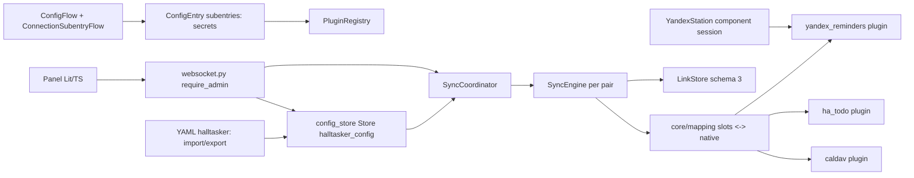

# HAlltasker — architecture v2 (draft 2.0, 2026-11-01)

> Language: English only (agent-facing, binding). There is no Russian reading copy yet; the owner maintains `docs/ru/`.

This document describes **how** [docs/v2/SPEC.md](SPEC.md) is implemented. The signatures and data structures here are binding for v2 issues. Until the owner starts the v2 implementation, [docs/ARCHITECTURE.md](../ARCHITECTURE.md) (v1.3) stays binding for every open v1 issue. Sections of v1.3 are cited as "v1.3 §N". Changes against v1.3 and the FR → section table are in §17.

## 1. Overview

```
Home Assistant
│
├── panel "HAlltasker" (Lit + TypeScript bundle, admin only)        §13
│        │ websocket halltasker/*                                   §9
│        ▼
custom_components/halltasker
├── __init__.py        async_setup: YAML import (§8), panel, websocket, services; async_setup_entry: stores, registry, coordinator
├── config_flow.py     HAlltaskerConfigFlow (single entry) + ConnectionSubentryFlow (credentials per connection)  §7
├── websocket.py       halltasker/* commands, all @require_admin                                                §9
├── panel.py           static path + panel_custom registration                                                  §13
├── yaml_io.py         halltasker: section ↔ ConfigDocument; export with !secret                               §8
├── coordinator.py     timers, events, one global lock, chained runs; pairs from the config store              §10
├── runtime.py         RuntimeSupervisor: drained generation mutations, recovery journal                       §10
├── sensor.py, diagnostics.py, services.yaml, strings.json, translations/{en,ru}.json, manifest.json        §12
├── core/                                   (no homeassistant imports)
│   ├── model.py         FieldSpec, ItemSchema, CanonicalItem, Capabilities, Snapshot, Link,
│   │                    Connection, Container, Node, ValueMap, FieldMap, Pair, DirectionRule, CanonicalTask facade  §2, §3
│   ├── config_store.py  ConfigDocument, validation, (de)serialization over a duck-typed storage                     §2, §7
│   ├── schema_builder.py prefill by role, type compatibility, default value maps, mapping warnings                  §2, §5
│   ├── mapping.py       CompiledMapping, compile_mapping, schema_for, to_slots, to_native, caps_for_slots           §5
│   ├── downgrade.py     per-field downgrade and equivalence                                                         §5
│   ├── diff.py, conflict.py, router.py, matching.py, actions.py   as v1.3, generalized to ItemSchema               §6
│   ├── engine.py        SyncEngine.run_pair over two NodePorts                                                      §6
│   └── link_store.py    LinkStore / PairLinks, schema 3                                                             §11
├── plugins/
│   ├── base.py          PluginDescriptor, Plugin, AuthFailed, NodeUnavailable                                      §4
│   ├── registry.py      PluginRegistry, BoundNode (plugin + connection + node + secrets → NodePort)                 §4
│   ├── ha_todo.py       todo.* entities                                                                             §4a
│   ├── caldav.py        CalDAV accounts (caldav library, executor)                                                  §4b
│   └── yandex_reminders.py  Alice reminders over the YandexStation session                                          §4c
└── frontend/            halltasker-panel.js (built bundle, committed)                                               §13
frontend/                Lit + TypeScript sources, package.json, rollup config (repository root, not shipped)        §13
```

Topology inside a pair is still a "star": a plugin knows only its own native fields; `core/mapping.py` translates native fields to the pair's slots and back. Plugins never see another plugin and never see a pair. The core never sees credentials: plugins receive them through `BoundNode` (§4), which lives outside `core/`.



## 2. Config model (`core/model.py`, `core/config_store.py`)

All structures are `dataclasses`, immutable (`frozen=True`), with explicit serialization to JSON-compatible dicts (`to_dict()` / `from_dict()`), no HA imports. Ids are `uuid4().hex`, generated by the core (`config_store.new_id()`), never edited by the user.

```python
@dataclass(frozen=True)
class Connection:
    id: str; name: str; plugin_id: str
    settings: Mapping[str, Any] = field(default_factory=dict)   # non-secret; e.g. yandex_station entry id for yandex_reminders
    interval: int = 300

@dataclass(frozen=True)
class Container:
    id: str; name: str; path: str | None = None; query: str | None = None

@dataclass(frozen=True)
class Node:
    id: str; name: str; connection_id: str; container: Container; kind: str = "task"

@dataclass(frozen=True)
class ValueMap:
    read: Mapping[str, str]            # native value -> canonical value
    write: Mapping[str, str]           # canonical value -> native value
    default: str | None = None

@dataclass(frozen=True)
class FieldMap:
    slot: str
    a: str | None                      # native field of node A; None = dropped
    b: str | None
    prefer: Literal["pair", "a", "b"] = "pair"
    value_map_a: ValueMap | None = None
    value_map_b: ValueMap | None = None

@dataclass(frozen=True)
class Pair:
    id: str; name: str; a: str; b: str                 # node ids
    mapping: tuple[FieldMap, ...]
    direction: Literal["both", "a_to_b", "b_to_a"] = "both"   # preset; expands to DirectionRule pair
    interval: int = 60; conflict: Literal["prefer_a", "prefer_b"] = "prefer_a"
    initial_sync: Literal["merge", "dry_run"] = "merge"; enabled: bool = True
    a_to_b: DirectionRule = DirectionRule(); b_to_a: DirectionRule = DirectionRule()
```

`mapping` has no default and therefore stands before `direction`: a dataclass field without a default cannot follow fields with defaults.

`DirectionRule`, `Filter`, `Transform`, `DeletePolicy` are unchanged from v1.3 §2 (including `Filter.require_due: bool | Literal["datetime"]` and `DirectionRule.delete_past_due`). `Filter.title_regex` and `Filter.require_due` read the slots `title` and `due`; `Transform` writes them.

`Connection.interval`: seconds, at least `PluginDescriptor.min_interval` (15 for `ha_todo`, 60 for `caldav`, 30 for `yandex_reminders`). The effective scheduling interval of a pair is `max(pair.interval, conn_a.interval, conn_b.interval)` (SPEC FR-1.8). Plugin defaults come from `PluginDescriptor.default_interval` and must be at least its minimum (§4).

```python
# core/router.py
def effective_rule(pair: Pair, direction: Literal["a_to_b", "b_to_a"]) -> DirectionRule:
    # direction preset "both" -> the stored rule
    # preset "a_to_b" and direction "b_to_a" (or the reverse) -> DirectionRule(create=False, update=False,
    #     complete=False, delete="false", delete_past_due=True, filter=Filter(), transform=Transform())
    # otherwise -> the stored rule
```

The engine (§6) reads rules only through `effective_rule`; the stored rules of the switched-off direction are kept so that switching the preset back restores them.

```python
# core/config_store.py
@dataclass(frozen=True)
class ConfigDocument:
    revision: int = 0                            # monotonically increasing commit revision
    connections: tuple[Connection, ...] = ()
    nodes: tuple[Node, ...] = ()
    pairs: tuple[Pair, ...] = ()
    def to_dict(self) -> dict[str, Any]: ...        # {"schema": 1, "revision": int, "connections": [...], "nodes": [...], "pairs": [...]}
    @classmethod
    def from_dict(cls, data: Mapping[str, Any]) -> "ConfigDocument": ...

@dataclass(frozen=True)
class ConfigError:
    path: str          # e.g. "pairs[yandex_icloud].mapping[status].value_map_a"
    message: str

def new_id() -> str                                                     # uuid4().hex
def validate(doc: ConfigDocument, descriptors: Mapping[str, PluginDescriptor],
             node_fields: Mapping[str, tuple[FieldSpec, ...]]) -> list[ConfigError]
    # node_fields: node id -> descriptor.fields for every node; a missing entry is a validation error
def validate_connection_data(connection: Connection, descriptor: PluginDescriptor,
                             credentials: Mapping[str, Any] | None = None, *,
                             require_credentials: bool = False) -> list[ConfigError]
def pair_contract(doc: ConfigDocument, pair_id: str,
                  descriptors: Mapping[str, PluginDescriptor]) -> PairContract
def links_to_reset(old: ConfigDocument, new: ConfigDocument,
                   descriptors: Mapping[str, PluginDescriptor]) -> frozenset[str]   # pair ids, SPEC FR-2.5
```

Validation rules (`validate`; an empty list = valid; any error rejects the whole document, SPEC FR-8.4):

1. `id` values are unique per kind; `name` values are unique per kind and non-empty.
2. Every `Node.connection_id` names an existing connection; every `Connection.plugin_id` is a registered plugin; `Node.kind` is in the plugin's kinds (`"task"` in v2). A plugin with `single_connection=True` has at most one connection in the document. `Connection.settings` contains only keys declared by that plugin's `settings_schema`; unknown keys are errors, not non-secret values passed through to a plugin, export or diagnostics. Required settings are present and every present value has its declared exact type (`boolean` is not an integer). A descriptor with `settings_schema[key].secret == true` is invalid at registry construction and cannot weaken this rule.
3. Every `Pair.a` / `Pair.b` names an existing node; `a != b`; both nodes have the same `kind`; no two pairs connect the same two nodes (either order). Within one connection, `(kind, container.id, container.path, container.query)` is unique across nodes, so duplicate node uuids cannot bind the same external container or hide a physical cycle. Aliases behind different connections or plugins cannot be detected by static validation; the forest guarantee covers only bindings it can identify.
4. **Forest:** union-find over the pairs in document order; a pair whose two nodes already share a root → `ConfigError(f"pairs[{name}]", "pairs form a cycle")` (v1.3 §7 rule 4).
5. `pair.interval >= 15`; every `connection.interval >= descriptor.min_interval` for its plugin.
6. Mapping: slot names unique in the pair and matching `[a-z][a-z0-9_]*`; the slot `title` exists with both sides set; a native field is used at most once per side; every set side names a field of that node's `FieldSpec`s that is readable. Every node has a `node_fields` entry taken from its descriptor; a missing entry is an error, never permission to skip field validation.
7. Type compatibility of a row with both sides set (`schema_builder.compatible(spec_a, spec_b)`): equal types; or `str`/`text` (slot type `text`); or `due`/`datetime` (slot type `due`). Anything else is an error. Reserved slots additionally require `title: str | text`, `status: enum` and `due: due | datetime`; an enum title, text status or integer due is invalid even if the two native rows are pairwise compatible.
8. Enum rows: the slot's canonical values are `("open", "done")` for the slot `status`; for another enum slot, the native values of side A, mapped through `value_map_a.read` when present. A side whose native values (mapped through its `read`) are not exactly the canonical values needs a value map; `read` must map every native value; `write` must map every canonical value to a native value the field accepts; `default`, when set, is a canonical value. For every statically writable side and canonical value `v`, `read[write[v]] == v`; many native values may still read as one canonical value. A value map on a non-enum row is an error.
9. When the effective rule toward side Y permits payload-bearing writes (`create` or `update`), a `due` slot mapped to a `datetime` field on Y requires `filter.require_due: "datetime"` (the v1.3 §7 rule 8, generalized to any plugin). Read-only, complete-only and delete-only directions do not need this filter.
10. Direction rules: `filter.title_regex` is a valid regex; a rule with `filter.require_due` true or a `transform.due` other than `keep` requires a `due` slot; `transform.title_prefix` requires a writable `title` on the target.
11. If the effective rule toward side Y has `create=True`, every target native `FieldSpec.required_create=True` is on a synchronized row and is statically writable. For a required `due` field, `transform.due: drop` is invalid because it makes every create impossible. No required-create mapping is imposed when `create=False`; dynamic capabilities are checked by the engine (§6).
12. A connection is referenced by a node → it cannot be absent from the document (this is how "delete is refused", SPEC FR-1.6, is enforced on save).

`validate_connection_data` is the common pure schema check for subentry flows, UI save and both YAML import paths. It always validates settings and, when a candidate credential mapping is supplied or `require_credentials=True`, validates credentials too. Unknown keys and missing required keys are errors; optional defaults satisfy presence, and values must match the declared exact type (`string`/`url` = `str`, `boolean` = `bool`, `integer` = `int` but not `bool`). `credential_kind == "none"` accepts no credentials; a credential plugin with `require_credentials=True` needs a mapping. Errors contain paths and stable messages such as `required`, `unknown_key` and `invalid_type`, never credential values. Every caller builds `node_fields` from descriptors for every node and runs `validate` plus this helper before any online call or side effect.

`pair_contract` returns the snapshot-compatibility contract of §11. Its binding fingerprint covers the ordered A/B node uuids, each node's kind, connection and container identity (`id`, `path`, `query`), and each connection's plugin and descriptor-declared identity settings. Its per-slot fingerprints cover the synchronized slot schema, both native bindings and both value maps. Names and other display metadata are excluded.

`links_to_reset(old, new, descriptors)` compares contracts of pairs present in both documents. An ordered A/B swap, binding change, removed slot, or changed slot fingerprint requires a confirmed reset. Adding a synchronized slot is compatible: existing links are kept, its absent historical value counts as changed once, and the contract metadata is extended. Reordering rows and changing `prefer`, conflict policy, direction rules or transforms do not reset links; new rules apply to subsequent observed changes and are not retroactive write requests. The websocket save also checks every incoming contract against retained link namespaces, including reintroduced pair uuids, before applying a reset (§9). Old snapshots are never parsed under an incompatible contract.

## 3. Item model (`core/model.py`)

```python
FieldType = Literal["str", "text", "enum", "due", "datetime", "int", "str_list"]
FieldCap = Literal["none", "partial", "full"]      # due: partial = date only

@dataclass(frozen=True)
class FieldSpec:
    name: str                 # native field name as the plugin names it
    type: FieldType
    role: str | None = None   # suggested slot: title, description, status, due, priority, tags
    read: bool = True
    write: bool = True
    values: tuple[str, ...] = ()   # enum only
    required_create: bool = False  # mapped/writable and non-empty on create; non-null when explicitly updated
    minimum: int | None = None  # inclusive; int fields only
    maximum: int | None = None  # inclusive; int fields only, minimum <= maximum

@dataclass(frozen=True)
class ItemSchema:             # built per pair from the mapping, not global
    kind: str                 # "task"
    fields: tuple[FieldSpec, ...]      # one per mapped slot, named by slot
    match_key: tuple[str, ...] = ("title", "due")

@dataclass(frozen=True)
class CanonicalItem:
    kind: str
    fields: Mapping[str, Any]          # slot (core) or native name (plugin boundary)

@dataclass(frozen=True)
class NodeListing:
    items: Mapping[str, CanonicalItem]
    filtered_ids: frozenset[str] = frozenset()  # intentionally ineligible external ids, never silent deletions

@dataclass(frozen=True)
class Capabilities:
    create: bool; update: bool; delete: bool
    fields: Mapping[str, FieldCap]     # writable shape, by native field name
    read_fields: Mapping[str, FieldCap] = field(default_factory=dict)
```

Rules:

- `ItemSchema.match_key` keeps only the slots of `("title", "due")` that the schema has; `title` is always present (§2 rule 6).
- `CanonicalItem.fields` holds a value for every field of the schema it was built for; an absent value is `None`. `__post_init__` freezes `fields` into a `MappingProxyType` over a copy and checks types per the schema when converted (`mapping.to_slots`); a `datetime` without `tzinfo` → `ValueError` (v1.3 §2 invariant).
- `Capabilities.fields` describes writable shapes; `read_fields` describes readable shapes, independently. Both are keyed by native name at the plugin boundary and by slot after `mapping.caps_for_slots` (§5); absent keys mean `none`. Static `FieldSpec.read/write=False` takes precedence. `partial` is defined for `due` only (date only); for other types it is treated as `full`. Read-only rows remain visible as informational data and never enter write planning.

`FieldSpec.minimum/maximum` are valid only for `int` fields and must be ordered when both are set. `model.normalize_value(spec: FieldSpec, value: Any) -> Any` validates the value and returns its canonical in-memory form. For `str_list`, native lists/tuples become a sorted, deduplicated `tuple[str, ...]` before diff, conflict, matching or hashing; `None` (absent) remains distinct from `()` (explicitly empty). `mapping.to_slots` and `Snapshot.of` always normalize through the relevant native/slot specs, so no raw set-like list reaches comparison or snapshot code.

Value serialization per type (`model.serialize_value(type, value)` / `parse_value(type, raw)`):

| Type | Python value | JSON |
|---|---|---|
| `str`, `text`, `enum` | `str \| None` | string or `null` |
| `due` | `dt.date \| dt.datetime \| None` | `"YYYY-MM-DD"` or ISO 8601 with offset; parsing as v1.3 §2 (10 characters without `T` = date; naive datetime = error) |
| `datetime` | `dt.datetime \| None` (tz-aware) | ISO 8601 with offset |
| `int` | `int \| None` | number or `null` |
| `str_list` | `tuple[str, ...]` | list of strings, **sorted and deduplicated** (compared as a set) |

```python
@dataclass(frozen=True)
class Snapshot:
    data: dict[str, Any]       # CanonicalItem.to_dict(schema) = {"kind": ..., "fields": {slot: serialized}}
    hash: str                  # sha256 of the canonical JSON (sort_keys=True, separators=(",", ":"))
    @classmethod
    def of(cls, item: CanonicalItem, schema: ItemSchema) -> "Snapshot": ...
    def item(self, schema: ItemSchema) -> CanonicalItem: ...   # slots missing in data -> None
```

`Link` is unchanged from v1.3 §2 except that `node` holds the **node uuid** and the snapshots hold slot data.

**`CanonicalTask` facade.** `CanonicalTask`, `FIELDS` and `TASK_SCHEMA` stay in `core/model.py` for the v1 tests and the `ha_todo` regression:

```python
TASK_SCHEMA = ItemSchema(kind="task", fields=(
    FieldSpec("title", "str", role="title"), FieldSpec("description", "text", role="description"),
    FieldSpec("status", "enum", role="status", values=("open", "done")), FieldSpec("due", "due", role="due")))

@dataclass(frozen=True)
class CanonicalTask:          # v1.3 §2, unchanged fields
    ...
    def to_item(self) -> CanonicalItem: ...                     # kind "task", fields of TASK_SCHEMA
    @classmethod
    def from_item(cls, item: CanonicalItem) -> "CanonicalTask": ...
```

## 4. Plugin contract v2 (`plugins/base.py`, `plugins/registry.py`)

`plugins/base.py` does not import `homeassistant` (the engine imports its exceptions, as in v1.3). Concrete plugins may import HA; each is constructed once with `hass` and serves every connection of its plugin id, keeping per-connection state (clients, retention stores) keyed by `connection.id`.

```python
@dataclass(frozen=True)
class PluginDescriptor:
    plugin_id: str; name: str
    credentials_schema: Mapping[str, Any]   # JSON-schema-like dict rendered by the panel; {} when credential_kind == "none"
    settings_schema: Mapping[str, Any]
    fields: tuple[FieldSpec, ...]
    credential_kind: Literal["none", "basic", "token"]   # none = built-in connection, no own credentials (ha_todo, yandex_reminders)
    default_interval: int = 300
    min_interval: int = 15
    kinds: tuple[str, ...] = ("task",)
    default_value_maps: Mapping[str, ValueMap] = field(default_factory=dict)   # native enum field -> map to open/done
    single_connection: bool = False         # ha_todo: exactly one built-in connection, created automatically
    identity_settings: tuple[str, ...] = ()       # settings that identify the external account
    identity_credentials: tuple[str, ...] = ()    # credential keys whose change means another account

class Plugin(ABC):
    descriptor: PluginDescriptor
    async def validate(self, connection: Connection, secrets: Mapping[str, str]) -> None      # AuthFailed | NodeUnavailable
    async def containers(self, connection: Connection, secrets) -> list[Container]            # discovery
    async def capabilities(self, connection: Connection, node: Node, secrets: Mapping[str, Any]) -> Capabilities
    async def list(self, connection: Connection, node: Node, secrets: Mapping[str, Any]) -> NodeListing
    async def create(self, connection: Connection, node: Node, item: CanonicalItem,
                     known_ids: frozenset[str], secrets: Mapping[str, Any]) -> str
    async def update(self, connection: Connection, node: Node, external_id: str,
                     item: CanonicalItem, changed: frozenset[str], secrets: Mapping[str, Any]) -> None
    async def delete(self, connection: Connection, node: Node, external_id: str, secrets: Mapping[str, Any]) -> None
    # reserved, not implemented in v2: async def create_container(...)

class AuthFailed(Exception): ...
class NodeUnavailable(Exception): ...
class UnsupportedTransition(Exception): ...          # valid node, unsupported requested value/transition
class DependencyUnavailable(NodeUnavailable):        # another HA component the plugin relies on is missing
    def __init__(self, domain: str, message: str) -> None: ...   # .domain, e.g. "yandex_station"
```

The descriptor fields after `credential_kind` and `DependencyUnavailable` extend the minimal contract; everything else is binding as listed. Identity keys must name declared settings/credentials and contain no secret-only rotation keys such as passwords or tokens.

Contract rules:

- `list` returns a **complete** `NodeListing`: `items` maps external ids to native `CanonicalItem`s and `filtered_ids` identifies every intentionally excluded, still-existing external object whose id is readable. `items` and `filtered_ids` are disjoint. Any error raises `NodeUnavailable` (or `AuthFailed`); silently returning a partial result is forbidden. An unidentifiable malformed object that could have been linked fails the complete read instead of being skipped (v1.3 §3, extended for explicit filtering).
- `create`, `update`, `delete` receive native names and an item that the core has already **downgraded** and translated (§5); `update` writes only the native fields in `changed`. The plugin makes no sync decisions and never sees slots, pairs or other plugins.
- `containers` returns only containers that exist now. `capabilities(node)` raises `NodeUnavailable("container not found")` when the node's container no longer resolves (SPEC FR-2.6).
- `validate` is called before a connection is saved and on reconfigure (§7). Built-in connections are validated too (`yandex_reminders` checks that the YandexStation entry exists).
- `secrets` is `{}` for `credential_kind == "none"`. A plugin never logs, stores or returns secrets.
- Every operational call receives the bound `Connection` explicitly; `node.connection_id == connection.id` is checked at binding. Settings are never inferred from an earlier `validate` or discovery call. Per-connection caches cannot leak settings or clients across connections.
- `credentials_schema` maps a key to `{"type": "string" | "boolean" | "integer" | "url", "required": bool, "default": Any, "secret": bool}`; credential `secret: true` keys are rendered as password inputs and exported as `!secret` by default (§8). `settings_schema` supports the same non-secret field metadata except that `secret: true` is forbidden: settings always live in the plain configuration document and diagnostics. `PluginRegistry.__init__` validates descriptors and raises `ValueError` for a secret-marked setting, undeclared identity key, identity rotation secret, `min_interval < 15`, `default_interval < min_interval`, or invalid `FieldSpec` numeric bounds before the registry can be used. Secrets must therefore be declared only as credentials and stored only in subentries.

```python
# plugins/registry.py
SecretsProvider = Callable[[str], Mapping[str, Any]]      # connection id -> subentry data ({} for built-in connections)

class PluginRegistry:
    def __init__(self, plugins: Iterable[Plugin]) -> None: ...
    def get(self, plugin_id: str) -> Plugin                 # KeyError for an unknown id
    def descriptors(self) -> dict[str, PluginDescriptor]
    def bind(self, node: Node, connection: Connection, secrets: SecretsProvider) -> "BoundNode"

class BoundNode:                                            # implements core.engine.NodePort
    node_id: str
    connection_id: str
    # fields() -> plugin.descriptor.fields; operations pass (connection, node, ..., secrets(connection.id)).
    # The binding belongs to one runtime generation; administrative mutation drains it before replacement (§10).
```

**Capability matrix** (native field → `FieldCap`, operations; `R` = read-only):

| Plugin | title | description | status | due | priority | tags | other | create / update / delete |
|---|---|---|---|---|---|---|---|---|
| `ha_todo` | `summary` full | `description` full if feature 64, else none | `status` full | `due`: full if feature 32, partial if 16 only, else none | — | — | — | features 1 / 4 / 2 |
| `caldav` | `SUMMARY` full | `DESCRIPTION` full | `STATUS` full | `DUE` full | `PRIORITY` full | `CATEGORIES` full | `COMPLETED` R | yes / yes / yes |
| `yandex_reminders` | `text` full | — | `status` full (cancel only, §4c) | `due` full (`datetime` type) | — | — | — | yes / yes / yes |

**Default value maps** (prefilled by `schema_builder.prefill` for the slot `status`, canonical `open | done`):

| Plugin, field | `read` (native → canonical) | `write` (canonical → native) | `default` |
|---|---|---|---|
| `ha_todo.status` | `needs_action → open`, `completed → done` | `open → needs_action`, `done → completed` | `open` |
| `caldav.STATUS` | `NEEDS-ACTION → open`, `IN-PROCESS → open`, `COMPLETED → done`, `CANCELLED → done` | `open → NEEDS-ACTION`, `done → COMPLETED` | `open` |
| `yandex_reminders.status` | `active → open`, `cancelled → done` | `open → active`, `done → cancelled` | `open` |

With these maps a CalDAV item in `IN-PROCESS` reads as `open`; it is rewritten to `NEEDS-ACTION` only if the `status` slot is written to it (a change from the other side), never by itself, because an unchanged canonical value is not a change.

**Future plugins with their own client** (`jira`, `yandex_tracker`; SPEC FR-13.4): a module in `plugins/`, a `Plugin` subclass registered in `__init__.py`; `credential_kind` `basic` or `token` with credentials only in the connection subentry; discovery returns projects as `Container(id, name, query=...)`; native fields with roles and `values` for enums (workflow statuses), so that the panel can build the value map; no import of the plugin from `core/`.

## 4a. Plugin `ha_todo` (`plugins/ha_todo.py`)

The v1.3 §4 plugin, moved to the v2 contract. Descriptor: `plugin_id = "ha_todo"`, `credential_kind = "none"`, `credentials_schema = {}`, `settings_schema = {}`, `default_interval = 15`, `single_connection = True`. The built-in connection is created by `async_setup_entry` when the config store has no `ha_todo` connection (§7).

Fields:

```python
FIELDS = (FieldSpec("summary", "str", role="title", required_create=True),
          FieldSpec("description", "text", role="description"),
          FieldSpec("status", "enum", role="status", values=("needs_action", "completed")),
          FieldSpec("due", "due", role="due"))
```

- `containers`: every state of the `todo` domain (`hass.states.async_all("todo")`) as `Container(id=entity_id, name=friendly_name or entity_id)`.
- `capabilities(node)`: from `supported_features` of `node.container.id` per the matrix in §4; `NodeUnavailable` per v1.3 §4 (state missing, `unavailable`, `unknown`).
- `list`, `create`, `update`, `delete`: the HA API facts of v1.3 §4 apply unchanged (services `todo.get_items` / `add_item` / `update_item` / `remove_item`, `blocking=True`, `ServiceValidationError` on unsupported fields, the `completed` attribute ignored), with native names instead of `CanonicalTask` fields: `summary` ↔ `item`/`rename`, `status`, `due` ↔ `due_date`/`due_datetime`, `description`.
- `create`: send only present, writable native keys. UID recovery keeps the v1.3 §4 `known_ids` exclusion, 3 attempts 1 s apart and `NodeUnavailable("created item not found")`, but compares only the actual requested writable projection, never the whole native item returned by HA. An omitted key (including dropped `status`, `due` or `description`) is a wildcard and is not compared with integration defaults; an explicitly present `None` requires an absent/`None` value and is not an omitted key. `status` is not sent by `add_item`: when requested, recovery expects its initial `needs_action`, then issues `update_item(status)` for a requested `completed` before returning the uid. This makes title-only/status-dropped create recovery and retry idempotent.
- `validate`: no-op.

## 4b. Plugin `caldav` (`plugins/caldav.py`)

The client knowledge of v1.3 §4a, moved from a `todo` platform into a plugin; no HA entity is created. Descriptor: `plugin_id = "caldav"`, `credential_kind = "basic"`, `default_interval = 300`, `min_interval = 60`, `settings_schema = {}`, `identity_credentials = ("url", "username")`,

```python
credentials_schema = {
    "url": {"type": "url", "required": True},
    "username": {"type": "string", "required": True},
    "password": {"type": "string", "required": True, "secret": True},
    "verify_ssl": {"type": "boolean", "required": False, "default": True},
}
FIELDS = (FieldSpec("SUMMARY", "str", role="title", required_create=True),
          FieldSpec("DESCRIPTION", "text", role="description"),
          FieldSpec("STATUS", "enum", role="status",
                    values=("NEEDS-ACTION", "IN-PROCESS", "COMPLETED", "CANCELLED")),
          FieldSpec("DUE", "due", role="due"),
          FieldSpec("PRIORITY", "int", role="priority", minimum=1, maximum=9),
          FieldSpec("CATEGORIES", "str_list", role="tags"),
          FieldSpec("COMPLETED", "datetime", write=False))
```

HA facts (checked in the installed HA 2026.9.4, `homeassistant/components/caldav/{__init__.py,api.py,manifest.json}`):

| What | How |
|---|---|
| Client | `caldav.DAVClient(url, username=..., password=..., ssl_verify_cert=verify_ssl, timeout=...)`; `client.principal()` performs the login |
| Auth error | `caldav.lib.error.AuthorizationError` with `err.reason == "Unauthorized"` → credentials error; other reasons = wrong URL or unexpected server answer |
| Transport errors | `requests.Timeout`, `requests.ConnectionError`, `caldav.lib.error.DAVError` |
| Collections with VTODO | `client.principal().calendars()`, then `calendar.get_supported_components()`; `KeyError`/`DAVError` from it means the server does not report components, and HA assumes `VTODO` is supported |
| Library pins | `caldav==2.1.0`, `icalendar==6.3.1`, `vobject==0.9.9` (the manifest of HA core `caldav`) |

All `caldav` calls are synchronous and run through `hass.async_add_executor_job`. The module imports the library as `import caldav` (absolute import; the plugin module name does not shadow it). Per-connection state holds one `DAVClient`, its secrets hash and one `asyncio.Lock`. Every client/session operation — validate, discovery, list, create/update/delete and client replacement after a secrets change — runs exclusively under that connection lock. The executor call is shielded; if the awaiting cycle is cancelled, the lock remains held while the worker future is awaited to completion, then cancellation is re-raised. Releasing the async lock at await cancellation while the synchronous worker still runs is explicitly forbidden.

- `validate`: build a client and call `principal()`; `AuthorizationError("Unauthorized")` → `AuthFailed`; other `AuthorizationError`, transport errors → `NodeUnavailable`.
- `containers`: the collections as above (assume VTODO when not reported, as HA does) → `Container(id=<URL path of the collection>, name=calendar.name or the path, path=str(calendar.url))`. `Container.id` is the identity (SPEC FR-2.3); `path` is the absolute URL used to open the collection without a new discovery.
- `list`: open the collection by `path` (fallback: discovery by `id`; not found → `NodeUnavailable("container not found")`); `calendar.search(todo=True, include_completed=True)`. A VTODO without `UID` fails the complete read because it cannot be proven unrelated to an existing link. With a UID, `RRULE`, `RECURRENCE-ID`, missing `SUMMARY` or another intentionally ineligible object puts that UID in `NodeListing.filtered_ids`; recurring series/exceptions are never returned as writable single tasks. Every eligible `icalendar_component` goes through `read_vtodo`; malformed values fail the complete read rather than becoming a silent partial result.
- `create`: the plugin generates the `UID` (`uuid4().hex`), builds the VTODO with `write_vtodo` and saves it in the collection; returns the `UID`, so no lookup is needed and `known_ids` is unused. The exact `save_todo` call shape is confirmed against `caldav==2.1.0` in the plugin issue (v1.3 §4a used `calendar.save_todo(**kwargs)`).
- `update`: `calendar.todo_by_uid(uid)` → `write_vtodo(component, item, changed, now)` → `todo.save(no_create=True, obj_type="todo")`; `NotFoundError` → `NodeUnavailable`.
- `delete`: `todo_by_uid(uid).delete()`.
- Transport errors in any call → `NodeUnavailable`; `AuthorizationError("Unauthorized")` → `AuthFailed`.

```python
def read_vtodo(vtodo: icalendar.Todo, tz: dt.tzinfo) -> dict[str, Any] | None                     # pure
def write_vtodo(vtodo: icalendar.Todo, fields: Mapping[str, Any], changed: frozenset[str],
                now: dt.datetime) -> None                                                    # pure, mutates
```

RFC 5545 mapping (moved from v1.3 §4a, now per native field):

| Native field | Read | Write |
|---|---|---|
| `SUMMARY`, `DESCRIPTION` | text; missing `DESCRIPTION` → `None` | set; `None` removes `DESCRIPTION` |
| `STATUS` | the `STATUS` value when present; without `STATUS`: `COMPLETED` present or `PERCENT-COMPLETE == 100` → `"COMPLETED"`, otherwise `"NEEDS-ACTION"` | `COMPLETED` → `STATUS:COMPLETED`, `PERCENT-COMPLETE:100`, `COMPLETED:<now UTC>` only if absent; `NEEDS-ACTION` → `STATUS:NEEDS-ACTION`, remove `COMPLETED` and `PERCENT-COMPLETE`; `IN-PROCESS` → `STATUS:IN-PROCESS`, remove `COMPLETED`; `CANCELLED` → `STATUS:CANCELLED` |
| `DUE` | `date` for `VALUE=DATE`; a datetime as tz-aware (floating time → `tz`) | `VALUE=DATE` for a `date`, tz-aware datetime otherwise; `None` removes `DUE` |
| `PRIORITY` | `1..9` → int; `0` or missing → `None`; any other value is malformed and fails the complete read, never a clamp or item skip | int `1..9`, enforced generically before the call; `None` removes `PRIORITY` |
| `CATEGORIES` | all `CATEGORIES` properties merged and normalized to one sorted, deduplicated tuple; missing → `None`, explicitly empty → `()` | one `CATEGORIES` property with the values; empty removes it |
| `COMPLETED` | tz-aware datetime or `None` | never written by the core (read-only) |

A VTODO without `DTSTAMP` (Yandex) is accepted on read and gets `DTSTAMP` on write (v1.3 §4a). Manifest `requirements` = the three pins above; `requirements_dev.txt` gets the same lines (as v1.2). For v2, SPEC §6.5 is the explicit, narrow exception to the repository's general dependency prohibition: IT-64 owns exactly these three additions in both files, and no other dependency edits are permitted.

## 4c. Plugin `yandex_reminders` (`plugins/yandex_reminders.py`)

The client knowledge of v1.3 §4b, moved from a `todo` platform into a plugin; no HA entity is created. HAlltasker has no credentials for Yandex: the plugin uses the live session of the installed YandexStation component.

Descriptor: `plugin_id = "yandex_reminders"`, `credential_kind = "none"`, `credentials_schema = {}`, `default_interval = 60`, `min_interval = 30` (as v1.4 FR-14.1), `identity_settings = ("yandex_station_entry",)`,

```python
settings_schema = {
    "yandex_station_entry": {"type": "string", "required": False},   # YandexStation entry unique_id; required when there are several
    "device": {"type": "string", "required": False},                 # speaker name or quasar device_id for reminders created from HA
    "push": {"type": "boolean", "required": False, "default": False},
}
FIELDS = (FieldSpec("text", "str", role="title", required_create=True),
          FieldSpec("due", "datetime", role="due", required_create=True),
          FieldSpec("status", "enum", role="status", values=("active", "cancelled")))
```

**Session provider** (facts of v1.3 §4b, unchanged; YandexStation sources, master 2026-11-01): `hass.data["yandex_station"][<entry unique_id>]` is a `YandexQuasar` whose `.session` is a `YandexSession` (`async post(url, json=..., headers=...)`, own CSRF handling and one retry after 401, raises `Exception("<url> return <status> status")` when retries are exhausted); `hass.data["yandex_station"]["speakers"]` = `{device_id: device}` with `device["quasar_info"]["device_id"]` and `device["name"]`. Nothing is imported from `custom_components.yandex_station`; the lookup is lazy on every call. `ALARM_HEADERS`, `RPC`, `_ENDPOINTS` (write endpoints `None` until stage 1), `get_reminders`, `create_reminder`, `update_reminder`, `cancel_reminder`, `reminder_body` keep their v1.3 §4b signatures; `resolve_session(hass, connection)` and `resolve_device(hass, connection)` take the connection settings instead of `RemindersNode`.

- Built-in connection: no subentry; the owner creates the connection in the panel and may set the settings above. No manifest dependency on `yandex_station` (hassfest cannot validate a custom domain).
- `validate` and every other call: YandexStation data missing, the entry missing, or several entries without `yandex_station_entry` → `DependencyUnavailable("yandex_station", ...)`. Session failures (`Exception` from the session, `aiohttp.ClientError`, `KeyError`, `ValueError`) → `NodeUnavailable`. HAlltasker never raises `AuthFailed` here: an expired session is repaired in YandexStation.
- `containers`: one `Container(id="reminders", name="Alice reminders")`.
- `capabilities`: before the stage-1 write endpoints exist, `create/update/delete=False` and every writable field is `none`, while `read_fields` remains full; reads and dry runs still work and unsupported writes are capability-gated without a plugin call. After stage 1, create/update/delete and writable fields are enabled per §4. `status` full means the supported cancel transition, not reopen.
- `list`: `get_reminders` → `NodeListing` of single-trigger reminders as `{"text": text, "due": datetime(tz=HA zone), "status": "active"}` keyed by reminder `id`, plus the retained items (below) as `status: "cancelled"`. Recurring or malformed entries with a readable id are reported in `filtered_ids`, never silently skipped; an unidentifiable malformed entry fails the complete read (§4).
- **Retention**: `Store(hass, 1, f"halltasker_reminders_{connection.id}")` with `{"retained": {id: {"text": ..., "due": iso, "cancelled_at": iso}}}`. An item cancelled through `status: cancelled` is written there before the API call; retained items absent from the API answer are listed as `cancelled` until `due + 1 day < now`, then dropped; a retained id that reappears in the API answer is dropped from the store (v1.3 §4b, v1.4 FR-14.5). Expiry is not a separate plugin/tombstone protocol: the engine observes an ordinary deletion and applies `router.effective_delete` to the last synced due. In particular, `delete_past_due: false` produces only the normal tombstone and leaves the counterpart untouched; cancellation before due continues to follow the configured delete policy. The store is plugin state, not configuration and not link data.
- `create`: final target validation guarantees an aware datetime `due` and non-empty `text`; `create_reminder(session, text, due, resolve_device(...), push)` → the reminder id.
- `update`: `status` `active → cancelled` → retain + `cancel_reminder`; `status` `cancelled → active` → `UnsupportedTransition("cannot reopen a cancelled reminder")`, recorded as `Failure(kind="other")` with no external call and no node-outage repair. `text`/`due` → `update_reminder`; before stage 1 the dynamic capabilities gate these writes instead of raising `NodeUnavailable("not supported")`.
- `delete`: `cancel_reminder` (a retained id is only dropped from the store).

## 5. Mapping and downgrade (`core/mapping.py`, `core/schema_builder.py`, `core/downgrade.py`)

```python
# core/mapping.py (pure)
@dataclass(frozen=True)
class CompiledMapping:
    schema: ItemSchema
    rows: tuple[FieldMap, ...]
    fields_a: tuple[FieldSpec, ...]
    fields_b: tuple[FieldSpec, ...]

def compile_mapping(pair: Pair, fields_a: tuple[FieldSpec, ...], fields_b: tuple[FieldSpec, ...]) -> CompiledMapping
def schema_for(pair: Pair, fields_a: tuple[FieldSpec, ...], fields_b: tuple[FieldSpec, ...]) -> ItemSchema
def to_slots(item: CanonicalItem, side: Literal["a", "b"], compiled: CompiledMapping) -> CanonicalItem
def to_native(item: CanonicalItem, side: Literal["a", "b"], compiled: CompiledMapping,
              changed: frozenset[str], caps: Capabilities, *,
              creating: bool) -> tuple[CanonicalItem, frozenset[str]]
def validate_native_target(item: CanonicalItem, changed: frozenset[str], side: Literal["a", "b"],
                           compiled: CompiledMapping, *, creating: bool) -> None
class TargetValueError(ValueError): ...
def caps_for_slots(caps: Capabilities, side: Literal["a", "b"], compiled: CompiledMapping) -> Capabilities
def slot_fingerprints(compiled: CompiledMapping) -> Mapping[str, str]
```

- `compile_mapping` runs static mapping validation and returns immutable metadata, including the per-side native specs and value maps. `schema_for` returns the same schema as `compile_mapping(...).schema`; no hidden cache or plugin I/O is allowed. Conversion validates values against both native specs and the compiled slot schema; snapshots are parsed only after the compatibility check in §11.
- `slot_fingerprints` hashes canonical JSON of each synchronized slot's `FieldSpec`, native field names and value maps. It excludes row order, conflict preferences, direction rules and transforms. `config_store.pair_contract` combines these fingerprints with the binding identity of §2.
- `schema_for`: one slot `FieldSpec` per row whose two sides are set, in mapping order. Slot type per §2 rule 7 (`due` wins over `datetime`, `text` over `str`); `values` per §2 rule 8; `read` = both native fields readable; `write` = at least one native field writable; `role` = the slot name when it is a known role. Rows with one side dropped are not in the schema. `match_key` per §3.
- `to_slots`: for every schema slot, takes the native field of `side` and normalizes it through its native spec before any comparison. Enum values go through `value_map_<side>.read`; an unmapped native value uses `default` when present, otherwise raises `ValueError` and fails the complete read without skipping the item or propagating deletions. An unknown canonical value is never passed through silently. Native fields not in the schema are discarded; errors contain field/error metadata, not values.
- `to_native`: project both item and `changed` through static writable specs and dynamic target `fields`, then rename and apply value-map writes. A canonical enum value without a `write` mapping raises `TargetValueError`. Omitted fields are absent keys, never `None` clear commands; an explicit writable clear retains its key with `None`. After projection it calls `validate_native_target` on the final native payload, so transforms, merge, downgrade and value maps cannot bypass target constraints. An empty projected update is locally accepted without a write, success counter or `last_written` update; it is not a node outage.
- `validate_native_target`: on create every `required_create` native field is present and non-empty (`None`, blank text and empty collections are empty; numeric zero is valid); on update an explicitly changed required-create field cannot be `None`. Every outbound value is checked against its native type, enum values, timezone-aware datetime requirement and declared numeric constraints before any plugin call. Out-of-range numbers are rejected, never clamped. It raises `TargetValueError` with a stable field/error code only, never a payload or secret value.
- `caps_for_slots`: keeps operation flags and translates read/write maps independently, intersecting them with static specs. Never upgrade a dynamic `none` because the native type is `datetime`.
- Classification compares both observed and baseline in the node's readable shape. Informational rows may be observed but cannot trigger writes/conflicts. Echo and target equivalence compare both operands only on the readable-and-writable projection of the actual requested payload, with identical downgrade/normalization. A target-unwritable slot is not part of that comparison. Project `changed` before `op_for_change`: dropping an unsupported field may leave a status-only `complete`. Accept unsupported changes locally so they do not repeat, without pretending an external write succeeded.

```python
# core/schema_builder.py (pure, used by validation and by the panel through websocket)
def prefill(fields_a: tuple[FieldSpec, ...], fields_b: tuple[FieldSpec, ...],
            defaults: Mapping[tuple[str, str], ValueMap]) -> tuple[FieldMap, ...]
    # one row per role present on both sides (slot = role), with default value maps where needed;
    # rows for fields without a counterpart are not created
def compatible(a: FieldSpec, b: FieldSpec) -> FieldType | None    # slot type or None
def warnings(pair: Pair, fields_a: tuple[FieldSpec, ...], fields_b: tuple[FieldSpec, ...]) -> list[str]
    # "field X of node A is not synchronized", "slot priority dropped: not provided by node B" (SPEC FR-4.7)
```

`defaults` is keyed by `(plugin_id, native field name)` and comes from the plugins' `default_value_maps` (§4).

```python
# core/downgrade.py
def downgrade(item: CanonicalItem, caps: Capabilities, schema: ItemSchema, tz: dt.tzinfo) -> CanonicalItem:
    # for each schema slot:
    #   caps.fields.get(slot, "none") == "none"            -> None
    #   type "due", value is datetime, cap == "partial"     -> value.astimezone(tz).date()
    #   otherwise                                           -> unchanged
def equivalent(observed: CanonicalItem, expected: CanonicalItem, caps: Capabilities,
                schema: ItemSchema, tz: dt.tzinfo) -> bool:
    # Compare both normalized operands on the same readable-and-writable projection, never a full observed hash.
    ...
```

`tz` is derived as in v1.3 §5. The `due: date_only` transform is applied before the downgrade (v1.3 §5).

## 6. Engine deltas (`core/engine.py`)

The algorithm of v1.3 §6 is kept step by step. This section lists only what changes.

```python
class NodePort(Protocol):                       # core/engine.py; implemented by plugins.registry.BoundNode
    node_id: str
    connection_id: str
    async def fields(self) -> tuple[FieldSpec, ...]: ...
    async def capabilities(self) -> Capabilities: ...                       # native names
    async def list(self) -> NodeListing: ...                                # native names + explicit filtered ids
    async def create(self, item: CanonicalItem, known_ids: frozenset[str]) -> str: ...
    async def update(self, external_id: str, item: CanonicalItem, changed: frozenset[str]) -> None: ...
    async def delete(self, external_id: str) -> None: ...

class SyncEngine:
    def __init__(self, store: PairLinks, ports: Callable[[str], NodePort],
                 clock: Callable[[], dt.datetime]): ...
    async def run_pair(self, pair: Pair, *, dry_run: bool) -> RunResult: ...
```

`ports(node_id)` replaces `registry.for_node(node)`; the coordinator passes a function that binds plugin, node and secrets (§4, §10). `run_pair(dry_run=True)` plans against a disposable copy of `PairLinks` and discards it, so neither the supplied namespace nor its persisted store changes.

```python
@dataclass(frozen=True)
class Failure:
    kind: Literal["auth", "dependency", "unavailable", "other"]
    ref: str | None                 # connection id / dependency domain / node id / None
    message: str                    # safe stable code/message, at most 300 characters
    node_id: str | None = None
    connection_id: str | None = None
```

`RunResult` keeps the v1.3 §6.1 step 9 fields, changes `actions_failed` to `list[tuple[Action, Failure]]`, and adds `failures: tuple[Failure, ...]` plus the summary fields `error_kind` and `error_ref`. `failures` aggregates the fatal cycle failure, if any, and every failed action rather than retaining only the first error; `error_kind`/`error_ref` describe the first failure for the compact status. `run_pair` maps `AuthFailed` → `("auth", connection id)`, `DependencyUnavailable` → `("dependency", its domain)`, any other `NodeUnavailable` → `("unavailable", node id)`, `UnsupportedTransition` → `("other", node id)` without an outage repair, any other exception → `("other", None)`, adding the bound node/connection context known by the engine. An action failure does not erase failures of earlier actions. The coordinator uses the typed failures for repairs issues (§10).

`Action.to_dict(schema)`, `Failure.to_dict()` and `RunResult.to_dict(schema)` are the single JSON-safe serialization boundary for websocket results/events, sensor attributes and diagnostics input. They use the pair's `ItemSchema` for every `Action.task`, serialize date/datetime and set values through §3, turn `changed` frozensets into sorted lists and MappingProxy-like fields into plain dicts, and represent each failed action as `{"action": ..., "failure": ...}` rather than an improvised nested tuple. No `CanonicalItem`, frozenset or mapping proxy leaks into the JSON encoder.

Plugins replace raw external exception text with stable safe messages at their operational boundary (`authentication failed`, `cannot connect`, `container not found`, `unsupported operation`, or a similarly fixed code). Request/response bodies, item payloads, URLs with userinfo and raw client/session exception strings are not propagated. `BoundNode` applies defense-in-depth redaction of every bound secret value and URL userinfo before an error crosses into core, and the engine enforces the 300-character bound before storing, logging or publishing a `Failure`.

| v1.3 §6.1 step | v2 |
|---|---|
| 1. Plugins and capabilities | `pa, pb = ports(pair.a), ports(pair.b)`; fetch native specs and capabilities; `compiled = mapping.compile_mapping(pair, fields_a, fields_b)`; `schema = compiled.schema`; translate capabilities with `caps_for_slots(native_caps, side, compiled)`; use `router.effective_rule` for both directions. From here on everything is in slots |
| 2. Full read | `listing_a = await pa.list()`, `listing_b` likewise. If either `filtered_ids` intersects any external id stored in a link for that node, the complete cycle fails with `Failure(kind="other")` before planning or writes and keeps all links; intentional filtering is never an ordinary deletion. Otherwise `snap_a = {eid: mapping.to_slots(it, "a", compiled) for eid, it in listing_a.items.items()}`, `snap_b` likewise. Disjointness, invalid values or unidentifiable malformed entries fail the complete read without deletion propagation |
| 3, 3a. Link state, new items | unchanged (node strings → node uuids) |
| 4. Classification | `classify(link, current, caps, schema, tz)` compares normalized readable projections; writable changes are projected per target before planning (§5). A new slot absent from history counts as changed; overlap resolves by `prefer` in one cycle |
| 5. Decision | table unchanged. `conflict.merge(a, changed_a, b, changed_b, schema, prefer_for)` with `prefer_for = lambda slot: row.prefer if row.prefer != "pair" else ("a" if pair.conflict == "prefer_a" else "b")`; `router.allowed` unchanged; `op_for_change(changed)` unchanged: `{"status"}` alone is `complete`; a schema without `status` never produces `complete` or `soft_delete` (`soft_delete` toward a side without a writable `status` slot is gated like an off capability, SPEC FR-7.2) |
| 5. Orphan matching | `matching.find_match(expected, new_X, caps_present, caps_X, schema, tz)`; key = `schema.match_key`; the orphan-update `changed` is computed over the schema slots |
| 6. New items | `matching.pair_up(new_a, new_b, caps_a, caps_b, schema, tz)` |
| 7. Initial cycle | unchanged |
| 8. Execution | For a create, a required-create target field with dynamic capability `none` gates the whole action as capability-off before payload construction; no partial external create is attempted. Other writes go through `mapping.to_native(downgrade(item, caps_X, schema, tz), side_X, compiled, changed, native_caps_X, creating=...)` and the port. `TargetValueError` from the final merged/transformed payload becomes an action `Failure(kind="other")` with bound node/connection context and no port call; snapshots are `Snapshot.of(..., schema)` in slots |
| 8a, 9 | unchanged |

```python
# core/conflict.py
def merge(a, changed_a, b, changed_b, schema: ItemSchema, prefer_for: Callable[[str], Literal["a", "b"]]) -> CanonicalItem
    # slots changed on one side only -> from that side; overlapping slots -> from prefer_for(slot); others -> a
```

`core/router.py`: `passes_filter(rule, item)` and `apply_transform(rule, item, tz)` read and write the slots `title` and `due` of a `CanonicalItem` (a missing slot = the filter condition on it is false and the transform on it is a no-op); `allowed`, `op_for_change`, `effective_delete` are unchanged. v1.3 §6.2 (Delete) and §6.3 (Actions) are unchanged, except that `Action.node` holds the node uuid and `Action.task` holds a `CanonicalItem` in slots.

## 7. Configuration store and ConfigEntry (`core/config_store.py`, `config_flow.py`)

HA facts (checked in the installed HA 2026.9.4 with `.venv/bin/python` and `inspect.signature`):

| What | How |
|---|---|
| Subentry flow types | `ConfigFlow.async_get_supported_subentry_types(config_entry) -> dict[str, type[ConfigSubentryFlow]]` (classmethod on the entry's flow) |
| Subentry | `ConfigSubentry(*, data: MappingProxyType, subentry_id, subentry_type: str, title: str, unique_id: str \| None)`; `entry.subentries` |
| Subentry flow helpers | `ConfigSubentryFlow.async_create_entry`, `async_update_and_abort(entry, subentry, *, unique_id, title, data, data_updates)`, `async_update_reload_and_abort`, `_get_entry()`, `_get_reconfigure_subentry()`, `source` (`SOURCE_USER = "user"`, `SOURCE_RECONFIGURE = "reconfigure"`) |
| Subentry management | `hass.config_entries.async_add_subentry(entry, subentry) -> bool`, `async_update_subentry(entry, subentry, *, data, title, unique_id) -> bool`, `async_remove_subentry(entry, subentry_id) -> bool` |
| Flow REST API used by the panel | `/api/config/config_entries/subentries/flow` and `/api/config/config_entries/subentries/flow/{flow_id}` (`homeassistant/components/config/config_entries.py`) |
| Repairs | `issue_registry.async_create_issue(hass, domain, issue_id, *, is_fixable, severity, translation_key, translation_placeholders=..., data=..., learn_more_url=...)`, `issue_registry.async_delete_issue(hass, domain, issue_id)` |
| Store | `Store(hass, version, key, private=False, *, atomic_writes=False, ...)` |

**Single entry.** `HAlltaskerConfigFlow` keeps the v1 import step (one entry, created from `async_setup`, §8) and gains a `user` step that creates the same single entry when there is no YAML (abort `single_instance_allowed` otherwise). `async_get_supported_subentry_types` returns `{"connection": ConnectionSubentryFlow}`.

**`ConnectionSubentryFlow`** — only for plugins with `credential_kind != "none"`:

- `async_step_user`: choose the plugin (only credential plugins), then either a new unique connection name or an existing connection of that plugin whose subentry is missing. The latter is the explicit restore path and retains that connection's uuid/name; it never adopts an orphan subentry by name. `async_step_credentials` builds a form from `credentials_schema` (`secret` keys as password selectors), runs `validate_connection_data(..., require_credentials=True)`, then awaits `plugin.validate(connection, secrets)`; `AuthFailed` → form error `invalid_auth`, `NodeUnavailable` → `cannot_connect`.
- On valid credentials, generate a uuid only for a new connection. Inside the §10 mutation, call `hass.config_entries.async_add_subentry` directly with `ConfigSubentry(subentry_type="connection", title=name, unique_id=connection_id, data={"plugin_id": ..., "secrets": {...}})`; for a new connection also append its non-secret document entry with `expected_revision` equal to the revision read when the flow started. Restore verifies that the same uuid still lacks credentials and adds no document entry. Complete the journal and reload, then finish the flow with `async_abort` (`subentry_created` or `credentials_restored`). Do not return `async_create_entry`: HA would auto-create a second subentry after the direct add.
- `async_step_reconfigure`: the same credentials form for `_get_reconfigure_subentry()`; empty `secret` inputs keep the stored values. A change to any `identity_credentials` key is rejected with `account_change_requires_new_connection`: account replacement uses a new connection and a confirmed node rebind/reset, while password/token/verify-settings rotation keeps the connection uuid and all links. Otherwise `validate`; inside the drained mutation return `async_update_reload_and_abort(entry, subentry, data=...)`, which performs the credential update and reload exactly once.
- The panel starts create, explicit restore and reconfigure through the subentry flow REST API above with the HA frontend's flow dialog; credential values never pass through `halltasker/*` commands.

The subentry of a connection is found by `subentry.unique_id == connection.id`. `SecretsProvider` (§4) = `lambda cid: dict(sub.data["secrets"])` for that subentry, `{}` for built-in connections.

**Built-in connections** (`credential_kind == "none"`) live only in the config store. `async_setup_entry` adds the `ha_todo` connection (`single_connection`) when it is missing. `yandex_reminders` connections are created by the owner through `halltasker/config/save`.

**Config store.** `Store(hass, 1, "halltasker_config")`; data = `ConfigDocument.to_dict()` (`{"schema": 1, "revision": int, "connections": [...], "nodes": [...], "pairs": [...]}`), never any secret. `core/config_store.py` exports, besides §2:

```python
class ConfigStoreError(Exception): ...
class UnsupportedConfigSchema(ConfigStoreError):
    schema: Any

class RevisionConflict(Exception):
    document: ConfigDocument                    # current stored document

class ConfigStore:                              # duck-typed storage as LinkStore (v1.3 §9)
    async def load(self) -> ConfigDocument       # None -> empty revision-0 document; existing invalid data raises
    async def save(self, doc: ConfigDocument, *, expected_revision: int) -> ConfigDocument
    @property
    def document(self) -> ConfigDocument
    def is_empty(self) -> bool
```

`load` treats only absent storage (`None`) as empty. An existing unsupported schema raises `UnsupportedConfigSchema`; malformed data and storage I/O failures raise `ConfigStoreError`. Neither is equivalent to empty and neither may trigger YAML import, subentry reconciliation/deletion or a store overwrite. Setup reports `config_invalid`, leaves the runtime `not_loaded` and all mutations blocked. Recovery requires an explicit owner restore/removal of the unreadable store followed by reload.

`save` compares the current revision under the administrative mutation boundary, raises `RevisionConflict` without writing when it differs from `expected_revision`, and otherwise stores `replace(doc, revision=expected_revision + 1)`. All UI, YAML and subentry mutations pass a base revision; only recovery may repeat an already committed revision idempotently.

**Consistency between store and subentries**, checked in `async_setup_entry`:

- A credential connection without its subentry (for example, the subentry was deleted in the HA integrations page) stays in the store; its nodes raise `AuthFailed("credentials missing")` through `BoundNode`, and the repairs issue `connection_auth_<connection id>` asks to re-create the credentials from the panel: a new subentry flow started for that connection may reuse its name (the uniqueness check of §2 rule 1 skips a credential connection without a subentry), and the new subentry gets `unique_id = connection.id`.
- A subentry without a connection in the store is left disconnected by default. It is adopted only when recovery of a committed journal operation names its `unique_id`, or when the owner explicitly restores it; an orphan left by a crashed deletion can therefore never resurrect a removed connection.
- Saving a document without a credential connection removes its subentry (`async_remove_subentry`) after the store is written (SPEC FR-1.6).

**Common static and scoped online preflight.** Subentry create/reconfigure, `config/save`, startup import and panel import all use `validate` + `validate_connection_data` with descriptor fields for every node. A document save cannot introduce a credential connection without credentials; use the subentry flow. YAML import validates its resolved candidate mapping; UI operations may use stored subentry values internally without returning them. Static errors stop the operation before any network call or side effect.

After static validation, compare the candidate with the loaded document. For every added connection or changed credentials/settings, await `plugin.validate(candidate_connection, candidate_secrets)`; this includes `credential_kind == "none"` connections and the automatic `ha_todo` creation. `AuthFailed` becomes `invalid_auth`, and `NodeUnavailable` becomes `cannot_connect`, at that connection's path. For every added node or changed `connection_id`/container identity, await `containers` on the candidate connection and require an exact `(id, path, query)` match; no match becomes `container_not_found`, and plugin failures reject the candidate. Startup import treats every connection/node as new and wraps any preflight errors as `YamlImportError`/`yaml_invalid` without creating subentries.

Unchanged connections and containers are not revalidated or rediscovered. Rename, mapping/direction edits, pair changes, link reset and deletion therefore remain available while an existing external resource is offline. Online preflight and reset preview have no config, link or subentry side effects. They may run before the drain; the mutation rechecks `base_revision` immediately before journaling and commits exactly the validated candidate.

**Repairs issues** (`is_fixable=False`, severity `error` unless noted, translations in `strings.json`):

| `issue_id` | When | Removed |
|---|---|---|
| `connection_auth_<connection id>` | any enabled pair has an active `Failure(kind="auth", ref=connection id)`, or that connection's subentry is missing | only when no active auth failure remains for the connection and credentials are present; one pair's success or reconfigure alone is insufficient |
| `dependency_<domain>` | any enabled pair has an active `Failure(kind="dependency", ref=domain)` (`yandex_station`); `learn_more_url` = the YandexStation documentation | when no enabled pair has an active failure for that domain |
| `config_invalid` | existing config storage has an unsupported schema, malformed data or an I/O failure; all mutation is blocked | after an explicit owner restore/removal and a successful load |
| `yaml_ignored` (warning) | a `halltasker:` section at startup while the store is not empty (§8) | when the section is removed or the store is emptied |
| `yaml_invalid` | a `halltasker:` section that fails validation, including a v1 section | after a successful import or when the section is removed |

## 8. YAML import and export (`yaml_io.py`)

Format (SPEC FR-9): the `halltasker:` section of SPEC FR-9.5. Keys:

```yaml
halltasker:
  connections:
    - id: <uuid hex>                # optional on import
      name: yandex1                 # unique, non-empty
      plugin: caldav                # plugin_id
      interval: 300                 # optional, default = plugin default_interval
      settings: {}                  # optional, keys of settings_schema
      credentials: {...}            # keys of credentials_schema; only for credential plugins; secret keys via !secret
  nodes:
    - id: <uuid hex>
      name: yandex1_dela
      connection: yandex1           # connection name
      container: {id: ..., name: ..., path: ..., query: ...}   # as returned by discovery; name/path/query optional
      kind: task                    # optional
  pairs:
    - id: <uuid hex>
      name: yandex_icloud
      a: yandex1_dela               # node names
      b: icloud
      direction: both               # both | a_to_b | b_to_a
      interval: 60
      conflict: prefer_a
      initial_sync: merge
      enabled: true
      mapping:                      # FieldMap rows: slot, a, b (native names or null), prefer, value_map_a, value_map_b
        - {slot: title, a: SUMMARY, b: summary}
      a_to_b: {}                    # v1.3 §7 direction rule keys, unchanged
      b_to_a: {}
```

```python
CONFIG_SCHEMA = vol.Schema({DOMAIN: dict}, extra=vol.ALLOW_EXTRA)    # permissive: a bad section must not fail HA startup

class YamlImportError(Exception):
    errors: list[ConfigError]

def parse_section(conf: Mapping[str, Any], descriptors: Mapping[str, PluginDescriptor]
                  ) -> tuple[ConfigDocument, dict[str, dict[str, Any]]]
    # -> (document, credentials by connection id); resolves names to ids, generates missing ids;
    #    voluptuous shape checks + the common static preflight with descriptor fields for every node
    #    and validate_connection_data(..., require_credentials=True) for every credential connection;
    #    raises YamlImportError. Online preflight is orchestrated by the caller before side effects.
    #    A v1 section (keys caldav / yandex_reminders, or pairs whose a/b are todo.* strings) -> YamlImportError("v1 format")
def render_section(doc: ConfigDocument, credentials: Mapping[str, Mapping[str, Any]],
                   descriptors: Mapping[str, PluginDescriptor], *, include_secrets: bool) -> tuple[str, str]
    # -> (YAML text of the halltasker: section, secrets.yaml template)
async def async_parse_text(hass, text: str, descriptors) -> tuple[ConfigDocument, dict[str, dict[str, Any]]]
    # homeassistant.util.yaml.parse_yaml(text, Secrets(Path(hass.config.config_dir))) in the executor, then parse_section
```

HA facts (installed 2026.9.4): `homeassistant.util.yaml.parse_yaml(content, secrets: Secrets | None = None)`, `homeassistant.util.yaml.Secrets(config_dir: Path)`; `!secret` in `configuration.yaml` is already resolved by HA before `async_setup` sees the section.

- **Startup import** (`async_setup`, as v1.3 §7 for the entry creation): the raw section is kept in `hass.data[DOMAIN]["yaml"]`; `async_setup_entry` loads the config store, and if it is empty and a section exists: `parse_section` → the §7 static preflight plus online validation of every connection and discovery of every container → add subentries for credential connections (`async_add_subentry`) → save with `expected_revision=0` in the journal sequence. No subentry exists before all preflight passes. If the store is not empty: `yaml_ignored`. On static or online `YamlImportError`: `yaml_invalid` with the first errors in the placeholders; nothing is imported.
- **`halltasker.reload`** (admin service, `async_register_admin_service` as v1.3 §7): `async_integration_yaml_config(hass, DOMAIN)`; store empty and section present → import as above; then `hass.config_entries.async_reload(entry_id)`, which re-reads the store.
- **Panel import** (`halltasker/config/import_yaml`): `async_parse_text` → the same static and scoped online preflight as `config/save` → the revision-checked, drained and journaled replace (§9). Existing credentials match only `subentry.unique_id == connection.id`: an import with a present UUID may rename that connection and rotate non-identity credentials; an import without a UUID always creates a fresh connection identity and never adopts credentials by name. Changing `identity_credentials` under an existing UUID is rejected; the account must be imported under a new UUID with confirmed resets. Missing connections are removed through the same journal. Unchanged offline resources are not revalidated or rediscovered.
- **Export** (`render_section`): connections, nodes, pairs in store order, references by name, `id` always present. A credentials key with `secret: true` is rendered as `!secret halltasker_<connection.id>_<key>` (a `SecretRef` value with its own representer on a `yaml.SafeDumper` subclass); stable uuids make keys unique across display-name collisions and renames. The template lists these keys with empty values. Non-secret credential keys (`url`, `username`, `verify_ssl`) are rendered as values. With `include_secrets=True`, secret values are rendered in clear text only after websocket `confirm: true`. That single admin-only export response is the sole credential-bearing response exception: it is never written to logs, events, diagnostics, stores or browser persistence, and every other command remains credential-free.

## 9. Websocket API (`websocket.py`)

Every handler is decorated with `@websocket_api.require_admin`, `@websocket_api.websocket_command({...})` and, when it awaits, `@websocket_api.async_response`; registered with `websocket_api.async_register_command(hass, handler)` in `async_setup` (HA 2026.9.4 facts: all four names exist in `homeassistant.components.websocket_api`, as do `result_message` and `event_message`). Handlers fetch the runtime (`ConfigStore`, `LinkStore`, `PluginRegistry`, `SyncCoordinator`) from the loaded entry; without a loaded entry they return the error `not_loaded`. Unknown ids return `not_found`. No response exposes raw subentry `data`. YAML export is the only credential-bearing result: ordinary export contains declared non-secret values but no secret values, and only `include_secrets: true` with `confirm: true` adds clear-text secrets (§8).

| Command (`type`) | Parameters | Result |
|---|---|---|
| `halltasker/plugins` | — | `{"plugins": [descriptor as dict: plugin_id, name, credential_kind, credentials_schema, settings_schema, fields, default_interval, min_interval, default_value_maps, single_connection, identity_settings, identity_credentials]}` |
| `halltasker/config/get` | — | `{"revision": int, "config": ConfigDocument.to_dict(), "credentials": {connection_id: {"present": bool, "keys_set": [key, ...]}}, "warnings": {pair_id: [str]}}` |
| `halltasker/config/save` | `config: dict`, `base_revision: int`, `confirm_reset: bool = False` | `{"ok": bool, "revision": int, "errors": [{"path", "message"}], "reset_pairs": [pair_id], "warnings": {pair_id: [str]}}`; stale input returns `ok: false, error: "revision_conflict"` with the current config/revision and no side effects |
| `halltasker/connections/containers` | `connection_id: str` | `{"containers": [Container as dict]}`; plugin errors → error `auth_failed` / `unavailable` |
| `halltasker/nodes/fields` | `node_id: str`, `pair_with: str \| None = None` | `{"fields": [FieldSpec as dict], "capabilities": Capabilities as dict}`; with `pair_with` (the B node) also `"prefill": [FieldMap as dict]` from `schema_builder.prefill` |
| `halltasker/pairs/dry_run` | `pair_id: str` | `{"result": RunResult.to_dict(schema)}` (runs even for a disabled pair under the same supervisor/coordinator lock; no external or link-state writes) |
| `halltasker/pairs/sync_now` | `pair_id: str` | `{"result": RunResult.to_dict(schema)}` (refused with `disabled` for a disabled pair) |
| `halltasker/status/subscribe` | — | first an event with all retained results, then an event `{"pair_id", "result"}` after every cycle, with every result encoded by `RunResult.to_dict(schema)`; `connection.subscriptions[msg_id] = runtime.subscribe_status(cb)`, so save/reload keeps the same subscription |
| `halltasker/links/list` | `pair_id: str` | `{"initialized": bool, "links": [{"canonical_id", "sides": {node_id: {"external_id", "tombstone", "title"}}}]}` |
| `halltasker/links/reset` | `pair_id: str`, `base_revision: int` | `{"ok": true}`; the same revision conflict contract as save, then link reset under the administrative mutation boundary |
| `halltasker/config/export_yaml` | `include_secrets: bool = False`, `confirm: bool = False` | `{"yaml": str, "secrets_template": str}`; `include_secrets` without `confirm` → error `confirmation_required` |
| `halltasker/config/import_yaml` | `yaml: str`, `base_revision: int`, `confirm: bool = False` | as `config/save`; without `confirm` only validates and returns the errors, current revision and pairs whose links would reset |

Parameter schemas are voluptuous (`vol.Required("pair_id"): str`, `vol.Optional("confirm", default=False): bool`, `vol.Required("config"): dict`); the content of `config` is validated by `ConfigDocument.from_dict` + `config_store.validate`, not by the voluptuous schema.

**`config/save` algorithm** (atomic, SPEC FR-8.4): compare `base_revision` with the loaded document; a mismatch returns `revision_conflict` with the current config/revision before any online call or side effect. Otherwise parse and run the §7 common static preflight with descriptor fields for every node, then scoped online validation of only added/changed connections and discovery of only added/rebound containers. Errors return without mutation. Build `pair_contract` for every incoming pair and take `reset = links_to_reset(old, new, descriptors) | link_store.incompatible_pairs(contracts)`; non-empty and not `confirm_reset`: return `ok: false` with `reset_pairs` at the same revision. Under the administrative mutation boundary recheck `base_revision`, returning `revision_conflict` if preflight raced another writer, then execute the journaled config/subentry/link sequence of §10 and rebuild through `hass.config_entries.async_reload(entry_id)`. The confirmation is valid only for that base revision and exact candidate. Ids of new entities are generated by the panel with `crypto.randomUUID()` without dashes or left empty and filled by `from_dict` with `new_id()`.

## 10. Runtime and coordinator (`runtime.py`, `coordinator.py`)

### Administrative mutations and recovery

`RuntimeSupervisor` is created in `async_setup` and lives in `hass.data` independently of config-entry reloads. Every scheduled, manual or dry-run cycle and every config/credentials/link mutation goes through it. A mutation first pauses new cycles, then awaits the active cycle task completely (cancellation of an await is not treated as completion), discards queued old-generation work and runs exclusively. Config save/import, link reset, subentry create/reconfigure/delete and reload therefore cannot overlap an engine that owns an obsolete `PairLinks`, `BoundNode` or configuration. Success increments the runtime generation, rebuilds and resumes; failure leaves scheduling paused until recovery reaches a consistent state.

HAlltasker-owned stores use `atomic_writes=True`. A private `Store(hass, 1, "halltasker_mutation", private=True, atomic_writes=True)` journals each administrative operation before its first side effect: operation uuid/kind, incoming non-secret document and revision, reset pair ids, and subentry create/delete/title metadata. It never contains credential values.

A config operation then: pre-creates new credential subentries from the live flow/import secrets; writes the config with `expected_revision`; resets and saves link namespaces; updates existing credentials/titles and removes deleted subentries; clears the journal; rebuilds the runtime. Existing-credential updates are after the config commit; identity credentials still follow §7 and cannot be replaced by import/reconfigure.

At startup, recovery runs before YAML import or subentry reconciliation. Comparing the journal revision with the actual config makes the operation idempotent: if the new revision is absent, operation-created subentries are removed and the old config/links remain; if it is present, pending resets/deletions/titles are completed forward. A committed connection whose new subentry was not durably written keeps its config and gets `connection_auth_<id>` for same-UUID credential restoration; no secret is reconstructed from the journal. Orphan subentries are adopted only when a committed journal operation references them or during an explicit owner restore, never automatically resurrected after deletion.

### Reload-independent status bus

`RuntimeSupervisor` owns the status snapshot and subscribers, not `SyncCoordinator`: `status_snapshot() -> dict[str, RunResult]`, `subscribe_status(callback) -> Callable[[], None]`, and `publish_status(pair_id, result)`. The websocket handler reads the initial snapshot and stores the returned unsubscribe callback in `connection.subscriptions[msg_id]`; callbacks never capture a coordinator. `publish_status` synchronously notifies the current subscribers after every scheduled, manual or dry-run cycle. A rebuild prunes results only for deleted or reset pair uuids, retains results for surviving pairs and leaves every subscription registered across save/import/credential reload.

### Failure aggregation and repairs

`RuntimeSupervisor` owns `pair_failures: dict[pair_id, tuple[Failure, ...]]` and the set of credential connections with missing subentries. `record_pair_result(pair, result, dry_run)` replaces exactly that pair's failure tuple from `result.failures` after a real cycle, then reconciles the issues of §7; a dry run changes no failure state and cannot clear an issue. Thus an issue exists while at least one enabled pair contributes its scoped auth/dependency failure, independent of other pairs' successes. Missing credentials are a separate connection-level active condition.

Setup/reload retains `pair_failures` in the supervisor and reconciles them with the new document: disabled and deleted pair uuids are pruned, surviving enabled pairs keep their failures, and deleted/reset status results follow the status-bus rule. Reconfigure may clear the missing-subentry condition after validated restoration, but never clears pair failures by itself. Setup also removes stale auth/dependency registry issues with no active in-memory condition before new cycles populate them. Issue reconciliation uses every typed failure, including write-action failures, rather than only `error_kind`/`error_ref`.

### Coordinator

The v1.3 §8 coordinator with these changes:

- `SyncCoordinator(hass, pairs: list[Pair], engine_factory: Callable[[Pair], SyncEngine], interval_for: Callable[[Pair], int], watched: Callable[[Pair], list[str]])`. `pairs` contains **all** configured pairs in document order, including disabled and never-enabled pairs. Only enabled pairs are scheduled, watched or chained. `interval_for(pair)` = the effective interval of §2. `watched(pair)` = the entity ids whose `state_changed` triggers the pair: the containers of its `ha_todo` nodes; nodes of other plugins have no events and rely on polling and chained runs.
- `engine_factory = lambda pair: SyncEngine(link_store.for_pair(pair, config_store.pair_contract(document, pair.id, descriptors)), ports, clock=dt_util.now)` with `ports = lambda node_id: registry.bind(nodes[node_id], connections[nodes[node_id].connection_id], secrets)` (§4, §6). `LinkCompatibilityError` blocks the cycle before snapshot parsing and is surfaced as a configuration error requiring explicit reset.
- One global lock, the cycle timeout, the 2-second debounce, chained runs and the `@callback` rule are unchanged (v1.3 §8), and chained runs use node uuids. Manual and dry-run lookup uses the complete pair dictionary. `sync_now` rejects a disabled pair; `dry_run` accepts it and enters the same `RuntimeSupervisor` administrative/cycle serialization and coordinator lock as a real run. A dry run performs reads/planning only, uses a disposable in-memory copy of link state, and causes no external write, link-store save or retained in-memory link mutation.
- After each cycle the coordinator calls `runtime.publish_status` and `runtime.record_pair_result`; the latter ignores dry runs and performs aggregated repairs reconciliation from all `RunResult.failures`.
- The coordinator is rebuilt only by an entry reload (`config/save`, `import_yaml`, the subentry flows, `halltasker.reload`); a running cycle finishes under the lock before `async_stop` returns.

`__init__.py`:

- `async_setup(hass, config)`: keep the raw `halltasker:` section; register `reload`, the websocket commands (§9) and the panel (§13); start the import flow when there is a section and no entry (v1.3 §7).
- `async_setup_entry`: load `LinkStore` and `ConfigStore`; YAML import into an empty store (§8); ensure the `ha_todo` connection; consistency with subentries (§7); build `PluginRegistry([HaTodoPlugin(hass), CalDavPlugin(hass), YandexRemindersPlugin(hass)])`, the coordinator and the sensors; register `sync_now`/`dry_run`; forward `["sensor"]`. No `todo` platform in v2.
- `async_unload_entry`: stop the coordinator, unload `["sensor"]`, remove `sync_now`/`dry_run`. The panel and websocket commands stay registered for the life of HA and answer `not_loaded`.

## 11. Link store (`core/link_store.py`), schema 3

`Store(hass, version=1, key="halltasker")` as in v1.3 §9; the data format moves to schema 3:

```json
{
  "schema": 3,
  "pairs": {
    "9b2e4c7a1f3d4e8b9a6c5d2e1f0a3b4c": {
      "nodes": ["3f1c9a0e2b7d4c51a8e6f0b9d2c4e7a1", "7d0e5b2c9a4f4b1e8c3a6d9f2e5b8c1a"],
      "kind": "task",
      "binding": "<sha256 of the ordered binding identity>",
      "slots": {"title": "<sha256>", "status": "<sha256>"},
      "initialized": true,
      "links": [ {Link as dict; node = node uuid; snapshots in slots} ]
    }
  }
}
```

`PairLinks` keeps the v1.3 §9 methods; `nodes` holds ordered node uuids and `kind` remains explicit. The stored contract prevents old snapshots from being parsed under new semantics:

```python
@dataclass(frozen=True)
class PairContract:
    binding: str
    slots: Mapping[str, str]              # synchronized slot -> semantic fingerprint

class LinkCompatibilityError(Exception): ...

class LinkStore:
    async def load(self) -> None
    async def save(self) -> None
    def to_dict(self) -> dict[str, Any]
    def incompatible_pairs(self, contracts: Mapping[str, PairContract]) -> frozenset[str]
    def for_pair(self, pair: Pair, contract: PairContract) -> PairLinks
    def reset(self, pair_id: str) -> None          # drop the namespace; the next for_pair creates an empty one
    def pair_ids(self) -> list[str]
```

Rules:

- `incompatible_pairs` is read-only and checks current and retained namespaces. A binding mismatch, a removed stored slot, or a changed fingerprint of a stored slot is incompatible. New current slots are compatible additions.
- `for_pair(pair, contract)` is keyed by pair uuid and checks the same contract before any snapshot is read. An incompatible namespace raises `LinkCompatibilityError`, remains untouched and blocks writes until an explicit confirmed reset; it is never silently reinterpreted or discarded. A compatible additive contract is merged into the namespace metadata and persisted with the next save, preserving every link.
- Configuration save takes the union of `links_to_reset(old, new, descriptors)` and `incompatible_pairs` over all incoming pair contracts, so removing and reintroducing a pair uuid cannot bypass confirmation. `reset(pair_id)` is used only after that confirmation or by `halltasker/links/reset` (§9).
- Namespaces of removed pairs, including their contracts, are kept untouched (v1.3 §9).
- `load()`: `None` → empty. `data.get("schema") != 3` (schema 2 of v1, or schema 1) → `WARNING "halltasker: link storage format is outdated and was discarded"` and empty store; the first cycle of every pair is an initial `merge` (SPEC §9.1).
- The duck-typed storage of v1.3 §9 is kept; the core does not import HA.

## 12. Sensors, services, diagnostics

- `sensor.py`: one `SensorEntity` per pair (enabled or not), `unique_id = f"halltasker_{pair.id}"` (uuid, so a rename keeps the entity), `name = f"HAlltasker {pair.name}"`; state and attributes as v1.3 §10 (SPEC FR-11.4), plus the attribute `pair_id` (uuid). Initial state comes from `runtime.status_snapshot()` and updates from `runtime.subscribe_status`, never a coordinator-owned subscription. Result attributes use `RunResult.to_dict(schema)`, not direct dataclass/dict improvisation.
- Services: `sync_now` and `dry_run` with optional `pair_id` = the pair uuid or name (SPEC FR-11.3); `reload` (§8). IT-71 registers their handlers during setup in `__init__.py`; IT-72 owns only their descriptions in `services.yaml`, not a second registration path.
- `diagnostics.py`: export `{"config": ConfigDocument.to_dict(), "credentials": {connection_id: {"present": bool}}, "store": redact_diagnostics(link_store.to_dict()), "results": redact_diagnostics({pair_id: result.to_dict(schema) for ...})}` over the runtime status snapshot. Subentry data is never read; declared connection settings are kept because §4 makes them non-secret (SPEC FR-12.3).
- `redact_diagnostics` is structural, not `async_redact_data` over a fixed set of names. A CanonicalItem-shaped mapping (`kind` + `fields`) keeps only `kind` and the field keys, replacing every `fields` value with `**REDACTED**` as a whole, including list/dict values such as `CATEGORIES` or a custom slot. A Snapshot-shaped mapping (`data` + `hash`) keeps `hash` and structurally redacts `data`. Link records allow only `canonical_id`, `node`, `external_id`, `last_seen_at`, `tombstone`, `tombstone_at` and redacted `last_observed`/`last_written`/`last_synced`; namespace metadata is limited to `nodes`, `kind`, `binding`, `slots`, `initialized`, `links` under the outer `schema`/`pairs`. Action dictionaries allow `kind`, `node`, `canonical_id`, `external_id`, `changed`, `reason` and a redacted `task`; Failure dictionaries allow `kind`, `ref`, `node_id`, `connection_id`, with error/message text redacted. Legacy/native payload keys `title`, `text`, `summary`, `description` are also redacted case-insensitively, but arbitrary custom and uppercase slot values are already covered by the structural `fields` rule. All other result metadata is limited to `ok`, `error_kind`, `error_ref`, `actions_planned`, `actions_applied`, `actions_failed`, `failures`, `links`; no raw plugin payload is exported.

## 13. Panel (`panel.py`, `frontend/`)

HA facts (installed 2026.9.4): `panel_custom.async_register_panel(hass, frontend_url_path, webcomponent_name, sidebar_title=None, sidebar_icon=None, js_url=None, module_url=None, embed_iframe=False, trust_external=False, config=None, require_admin=False, config_panel_domain=None, handle_safe_area=False)`; `hass.http.async_register_static_paths([StaticPathConfig(url_path, path, cache_headers=True)])` with `StaticPathConfig` from `homeassistant.components.http`; `frontend.async_remove_panel(hass, frontend_url_path, *, warn_if_unknown=True)`.

`panel.py`:

```python
PANEL_URL = "halltasker"
STATIC_URL = "/halltasker_static"

async def async_register_panel(hass: HomeAssistant) -> None:
    # await hass.http.async_register_static_paths(
    #     [StaticPathConfig(STATIC_URL, str(Path(__file__).parent / "frontend"), cache_headers=False)])
    # await panel_custom.async_register_panel(hass, frontend_url_path=PANEL_URL,
    #     webcomponent_name="halltasker-panel", sidebar_title="HAlltasker", sidebar_icon="mdi:sync",
    #     module_url=f"{STATIC_URL}/halltasker-panel.js?v={VERSION}", require_admin=True, config={})
```

`VERSION` is the manifest version, so a new release busts the browser cache. Manifest `dependencies` become `["http", "panel_custom", "websocket_api"]` (`todo` is no longer needed: `ha_todo` calls the `todo` services only when such entities exist, and `after_dependencies: ["todo"]` keeps the ordering).

**Sources and build** (SPEC §6.6): `frontend/` at the repository root (not shipped by HACS) with `package.json`, `tsconfig.json`, `rollup.config.mjs`, `src/`. Dependencies: `lit`, `typescript`, `rollup` with `@rollup/plugin-typescript`, `@rollup/plugin-node-resolve`, `@rollup/plugin-terser`. `npm run build` writes one ES module `custom_components/halltasker/frontend/halltasker-panel.js`, which is committed. Python checks do not need Node.js. The panel uses the `hass` object that HA passes to the custom element (`hass.connection.sendMessagePromise`, `subscribeMessage`, `hass.language`) and HA's own elements available in the frontend (`ha-card`, `ha-button`, form selectors); no other runtime dependency.

`src/` layout:

```
src/halltasker-panel.ts        root element: tabs, routing, hass property, status subscription
src/api.ts                     typed wrappers for the §9 commands and the subentry flow dialog
src/types.ts                   TypeScript mirrors of the §2/§3 dicts
src/views/connections.ts       Connections (SPEC FR-10.2)
src/views/nodes.ts             Nodes, container picker from discovery (FR-10.3)
src/views/pairs.ts             Pairs list and forest graph (FR-10.4)
src/views/pair-editor.ts       Pair editor (FR-10.5)
src/views/status.ts            Status, dry run, links (FR-10.6)
src/views/yaml.ts              Export / Import (FR-10.7)
src/components/field-mapper.ts two columns of native fields, rows, drop / re-bind, prefer, warnings
src/components/value-map.ts    enum value-map editor
src/localize.ts                en/ru strings
```

Screens (SPEC FR-10):

- **Connections**: `config/get` + `plugins`; "Add" opens the subentry flow (§7) for credential plugins, or adds a built-in connection to the document for `yandex_reminders`; "Credentials" opens the reconfigure flow; settings and rename are document edits; delete is disabled while nodes refer to the connection.
- **Nodes**: choose a connection, then `connections/containers`; show `name` and `id` of each container; changing the container of an existing node shows the pairs whose links will reset (from the `config/save` answer) and asks for confirmation.
- **Pairs**: table plus a simple forest graph; a save that would form a cycle shows the `config/save` error.
- **Pair editor**: `nodes/fields` for A with `pair_with` = B gives both columns and the prefilled mapping; each row shows slot, native field of A, native field of B, types and capabilities, `prefer` (pair / A / B) and, for enum rows, the value-map editor with the plugin defaults; unmapped native fields stay in their column and can be dragged into a row; the warnings from `config/save` are shown before the final save. Direction preset as three buttons (both, A→B, B→A) with the effective rules shown read-only for the switched-off direction. "Dry run" saves the pair disabled and calls `pairs/dry_run`.
- **Status**: `status/subscribe`; per pair state, last run, counters, last error, planned actions; buttons `pairs/sync_now`, `pairs/dry_run`, `links/list`, `links/reset` (with confirmation).
- **Export/Import**: `config/export_yaml` with copy and download of both texts; the "include secrets" switch asks for confirmation; `config/import_yaml` validates first (`confirm: false`), shows errors and link resets, then applies with `confirm: true`.

**i18n**: panel strings live in `src/localize.ts` for `en` and `ru`, chosen by `hass.language`; flow, repairs and service texts stay in `strings.json` and `translations/{en,ru}.json`.

## 14. Logging

As v1.3 §11 (one `INFO` line per cycle, actions at `DEBUG`, `NodeUnavailable` rate-limited `WARNING`), with pair and node **names** in the messages and uuids at `DEBUG`. Never logged: subentry data, `secrets` arguments, request headers of plugins, the YandexStation session. `AuthFailed` is logged once per connection until it clears.

## 15. Testing

Rules of v1.3 §12 apply (pure core tests, fakes from `tests/core/fakes.py`, no network, phacc fixtures). Child-SPEC `Files` lists grant scoped, not necessarily exclusive, ownership: IT-61 owns only `effective_rule` in `core/router.py` while IT-66 owns its v2 generalization; IT-62 owns downgrade and its regression port; IT-64 alone adds the three approved CalDAV pins to `manifest.json` and `requirements_dev.txt`, while IT-73 retains its listed frontend-related manifest changes; IT-69, IT-70 and IT-71 share `__init__.py` only for YAML entry points, websocket registration and setup/runtime/service-handler assembly respectively. Every file a task must change must appear in its own `Files` list.

New and changed modules:

- `tests/core/test_model.py`: immutable item copies, typed JSON round trips, aware datetimes, `NodeListing` with eligible items and explicit filtered ids, `required_create` and numeric-constraint metadata, and canonical `str_list` normalization (`None` versus empty, sorted/deduplicated tuple, stable snapshot hashes).
- `tests/core/test_mapping.py`: `schema_for` (types, dropped rows, match key), `to_slots` / `to_native` with value maps and defaults, `caps_for_slots`, non-writable native fields. Enum tests prove writable `read(write(v)) == v`, many-to-one reads, default fallback and safe failure for unknown native/canonical values. Reordered/duplicated `str_list` input is normalized before diff/hash, with `None` distinct from empty. Final target validation covers required-create presence/non-empty values, explicit `None` on update, every native type/enum/aware-datetime/numeric constraint after transforms and value maps, out-of-range rejection without clamp, and errors without payload values.
- `tests/core/test_schema_builder.py`: `prefill` by roles with default value maps, `compatible`, `warnings`.
- `tests/core/test_config_store.py`: every validation rule of §2 (one test per rule), duplicate physical bindings and hidden cycles, `pair_contract`/`links_to_reset` (rename = no reset; identity/semantic mapping change = reset; additive slot = compatible), `ConfigDocument` round trip, schema handling. Reserved slot types and enum write/read round trips reject invalid maps even when native coverage is total. Rule 9 is tested separately for create/update versus read-only/complete/delete-only directions; required-create mappings and `transform.due: drop` are checked only when target create is enabled. `validate_connection_data` covers required/unknown keys and exact settings/credential types for every caller; missing descriptor fields for a node are errors, and secret-shaped unknown settings never pass through/export.
- `tests/core/test_engine_v2.py`: the SPEC §7 C scenarios that are engine-level (C2–C5, C6 rename, C7) with `FakePlugin` ports over native names and value maps; per-field `prefer`; a slot added to the mapping converges in one cycle. A dynamically unwritable required-create field gates the whole create without a plugin call, while an invalid final required value produces `Failure(kind="other")`, also without a call. Multiple write failures produce typed `Failure` entries in `actions_failed` and the aggregated `RunResult.failures`, with bound node/connection context and no credential values. `NodeListing` disjointness is enforced; a filtered id present in stored links fails the whole cycle before planning/writes and cannot delete its counterpart, while an unlinked filtered id is not a deletion. `UnsupportedTransition` maps to typed `other` with node context and no outage repair. A cancelled reminder disappearing after retention expiry uses the ordinary deletion planner: `delete_past_due: false` yields only a tombstone and no counterpart write, while the `true` control follows the configured policy. Dry run leaves the supplied namespace and store untouched. `Action`/`RunResult.to_dict(schema)` round through the standard JSON encoder with dates, sets, frozensets, mapping proxies and failed-action entries.
- `tests/core/test_engine*.py`, `test_diff.py`, `test_conflict.py`, `test_matching.py`, `test_downgrade.py`, `test_router.py` (v1): preserve every regression scenario and assertion, but port test calls and fixtures where the v2 signatures require it. They run through the `CanonicalTask` facade and `TASK_SCHEMA`; `tests/core/fakes.py` changes so that `FakePlugin` acts as a `NodePort` returning `NodeListing` with the `ha_todo` native names and an identity mapping. Byte-for-byte unchanged test bodies are not required.
- `tests/core/test_link_store.py`: schema 3 contract format, binding/slot mismatches fail closed, additive slots, retained namespace reintroduction, confirmed `reset`, schema 2 data discarded.
- `tests/plugins/test_registry.py`: descriptor metadata and operational forwarding, including `NodeListing` and `UnsupportedTransition` without conversion to `NodeUnavailable`; `secret: true` in `settings_schema`, undeclared identity keys, identity rotation secrets, invalid numeric bounds and inconsistent default/minimum intervals fail registry construction before binding. Config tests cover `single_connection`, per-plugin minima and pair kind compatibility. BoundNode error fixtures prove secret/userinfo redaction before errors cross into core.
- `tests/plugins/test_ha_todo.py`: as v1 with native names and `containers`, plus projected UID recovery for title-only and status/due/description-dropped creates, omitted keys versus explicit `None`, post-recovery completed-status update, and retry after failed lookup without duplicates.
- `tests/plugins/test_caldav.py`: `read_vtodo` / `write_vtodo` on `icalendar.Todo` built from strings (the RFC 5545 rows of §4b, Yandex fixtures without `DTSTAMP`, `PRIORITY`, multiple `CATEGORIES`); `validate`/`containers`/`list` with a fake `DAVClient` (no network), `AuthorizationError` → `AuthFailed`. List fixtures cover `RRULE`, `RECURRENCE-ID`, missing `SUMMARY`, missing `UID`, disjoint returned/filtered ids and malformed values. Suspended fake executor calls prove that engine operations, discovery, validation and client replacement serialize per connection, and that cancellation holds the lock until the worker finishes before the next call starts.
- `tests/plugins/test_yandex_reminders.py`: the v1.3 §12 reminder tests moved to the plugin (fake `hass.data["yandex_station"]`, fake session), `DependencyUnavailable` when YandexStation data is missing, retention through the exact `due + 1 day < now` boundary, reappearance cleanup, and filtered recurring/malformed entries. Retention-expiry output feeds the engine regression for `delete_past_due` rather than a plugin-specific tombstone path. Before stage 1, full reads/dry runs remain available with no writable fields or operations and no plugin write call; after stage 1, create/cancel work and reopen raises `UnsupportedTransition` without an external call or outage. Cold-start operations on two connections use distinct account/device/push settings without prior validation or discovery.
- `tests/test_config_flow.py`: single entry, `ConnectionSubentryFlow` new/explicit-restore/reconfigure steps with a fake plugin, static schema errors before network, `invalid_auth` / `cannot_connect`. Creation directly adds exactly one subentry, advances the revision and finishes with `async_abort` rather than an automatic duplicate; restoration keeps the existing uuid/name/links and never adopts an orphan by name. Rotation uses `async_update_reload_and_abort` once; identity changes are rejected without side effects.
- `tests/test_runtime.py`: a suspended write versus reset/container/account mutation proves complete drain and no old-generation write; fault injection after every journal step verifies idempotent rollback/forward recovery, no orphan resurrection and no credentials in the journal. Status subscribers and surviving-pair results survive runtime replacement; deleted/reset pair results are pruned. Two pairs sharing a connection/domain prove aggregated repairs: one success or reconfigure cannot clear the other's active failure, the final real success can, dry runs cannot, and disable/delete/reload reconcile exactly their own contributions.
- `tests/test_coordinator.py`: all pairs resolve for manual commands while only enabled pairs schedule/watch/chain. A never-enabled dry run waits for the same supervisor/coordinator lock as a real cycle and returns actions without external calls, link saves or retained link mutation; sync-now refuses it.
- `tests/test_websocket.py`: every command of §9 through the phacc `hass_ws_client` fixture, admin requirement (non-admin user → `unauthorized`), atomic save with errors, `confirm_reset`, stale `base_revision`, `config/get` without secrets. Static preflight rejects the same schema errors as YAML; online validation/discovery covers only added/changed connections and added/rebound containers, while an unchanged offline resource permits unrelated edits/reset/deletion. Default YAML export may contain only declared non-secret credential values; the sole credential-bearing response exception is confirmed clear-text export, rejected without `include_secrets` + `confirm` and absent from every other response, event and persisted store. Subscribe → save/reload → next cycle delivers on the original subscription without coordinator-specific callbacks. Disabled dry run and every result/event use the common JSON-safe serializer; hostile external error fixtures expose no secret, userinfo, body or task payload and are bounded.
- `tests/test_yaml_io.py`: `parse_section` (names → ids, v1 section rejected), full static settings/credentials/node-field preflight, `render_section` with `!secret` and template, round trip, startup import into an empty store and `yaml_ignored` otherwise. Startup online validation and discovery of every new resource finish before any subentry exists; static/auth/dependency/discovery failures import nothing. Stable UUID secret keys survive renames and display-name reuse/collisions; import with the same UUID renames and rotates the existing subentry, while an absent UUID creates fresh credentials rather than adopting by name. Existing-UUID account-identity changes are rejected; ordinary and confirmed exports expose only their declared credential classes. A round trip that clears only `halltasker_config` and preserves schema-3 links makes no writes; existing unsupported/malformed config fails closed without import, reconciliation or overwrite.
- `tests/test_diagnostics.py`: custom slot names, uppercase native names, `title`/`text` payloads and `CATEGORIES`/list values are absent from store/result exports regardless of case; item kind/field keys, snapshot hashes, allowed action/link metadata and declared non-secret settings remain. Subentry data and failure messages are never read/exported.
- `tests/test_e2e.py`: kept; the in-memory `todo` platform now feeds `ha_todo` nodes of a store-built configuration.
- The frontend has no automated tests in v2; it is checked manually against SPEC §7 C.

## 16. Future extension

- `create_container` (reserved in §4): CalDAV `MKCALENDAR`, tracker projects; the panel would offer "create" next to discovery.
- A local hub container: a HAlltasker-owned store plugin that keeps every field, to connect rich nodes through a wide middle node in a forest; it is an ordinary plugin, not an N-node group.
- Trackers: `jira`, `yandex_tracker` plugins under §4 "Future plugins"; BuyMeAPie and shopping items need a new `kind` with its own fields, possible through `ItemSchema` without engine changes.
- Other kinds (calendar events) remain a low-priority idea (decision of 2026-10-28).

## 17. Changes against v1.3

Source: SPEC v2 (draft 2.0), the owner's decisions of the v2 planning session (2026-11-01), IT-41, IT-46. v2 is a new document; v1.3 is not edited.

- §1: new modules `core/mapping.py`, `core/schema_builder.py`, `core/config_store.py`, `plugins/caldav.py`, `plugins/yandex_reminders.py`, `websocket.py`, `panel.py`, `yaml_io.py`, `frontend/`; removed `todo.py`, `caldav_client.py`, `reminders_todo.py`, `schema.py` (replaced by `yaml_io.py` and `core/config_store.py`).
- §2: configuration dataclasses `Connection`, `Container`, `Node`, `ValueMap`, `FieldMap`, `Pair` (replaces `SyncPair`), `ConfigDocument`, validation rules; `effective_rule` for direction presets. `CalDavAccount`, `CalDavList`, `RemindersNode` removed.
- §3: `FieldSpec`, `ItemSchema`, `CanonicalItem`, per-field `Capabilities`; `Snapshot` per schema; `CanonicalTask` kept as a facade.
- §4: plugin contract v2 (descriptor, validate, discovery, secrets, `AuthFailed`, `DependencyUnavailable`), `PluginRegistry.bind`/`BoundNode`; capability matrix and default value maps. §4a–§4c: the three plugins; the v1.3 §4a/§4b platforms become plugins.
- §5: mapping between native fields and slots; per-field downgrade. §6: engine over `NodePort`s and `ItemSchema`; `merge` with `prefer_for`; typed `Failure`, aggregated `RunResult.failures` and summary `error_kind`/`error_ref`; the decision table and §6.2 unchanged.
- §7–§9: ConfigEntry subentries for credentials, config store, repairs issues, YAML import/export, websocket API. §10: coordinator from the store. §11: link store schema 3. §12–§15: sensors by uuid, diagnostics, panel, logging, tests.

FR → section table:

| SPEC v2 | ARCHITECTURE v2 |
|---|---|
| FR-1 Connections | §2 (`Connection`, rules 1, 2, 5, 11), §4 (`validate`, `credential_kind`), §7 (subentries, built-in connections, repairs), §10 (effective interval) |
| FR-2 Nodes and discovery | §2 (`Node`, `Container`, `links_to_reset`), §4 (`containers`), §4a–§4c (discovery per plugin), §11 (`for_pair`, `reset`) |
| FR-3 Pairs and directions | §2 (`Pair`, rules 3, 4, 10, `effective_rule`), §6, §10 |
| FR-4 Field mapping and value maps | §2 (`FieldMap`, `ValueMap`, rules 6–9), §4 (default value maps), §5 (`schema_builder`, `mapping`), §13 (pair editor) |
| FR-5 Item schema and capabilities | §3, §5 (`schema_for`, `downgrade`) |
| FR-6 Change detection and conflicts | §6 (classification, `merge` with `prefer_for`) |
| FR-7 Deletion | §6 (v1.3 §6.2 unchanged, `soft_delete` gating) |
| FR-8 Storage | §7 (config store, subentries), §9 (atomic save), §11 (link store schema 3) |
| FR-9 YAML import and export | §8 |
| FR-10 Panel | §13 |
| FR-11 Websocket API and services | §9, §12 |
| FR-12 Security and diagnostics | §4 (secrets rules), §7, §9 (`require_admin`, no subentry data), §12 (diagnostics), §14 |
| FR-13 Plugins | §4a, §4b, §4c, §4 (future plugins) |
| FR-14 Migration from v1 | §8 (v1 section rejected, `yaml_invalid`), §11 (schema 2 discarded), §17 (removed modules) |
